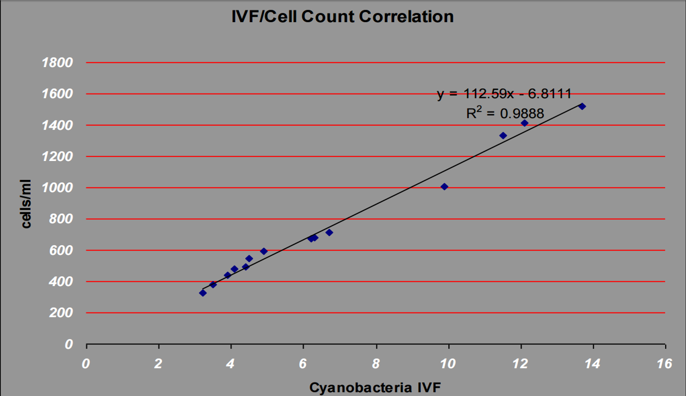
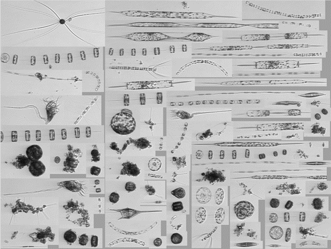
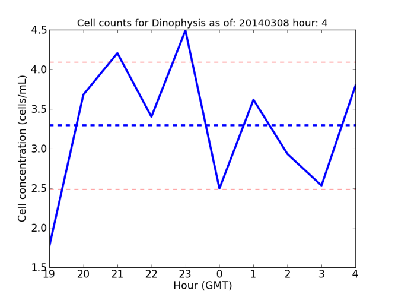
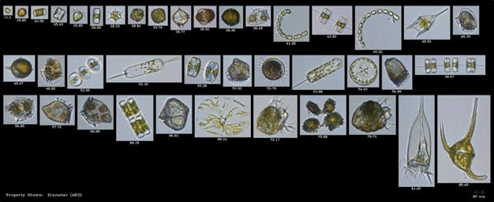
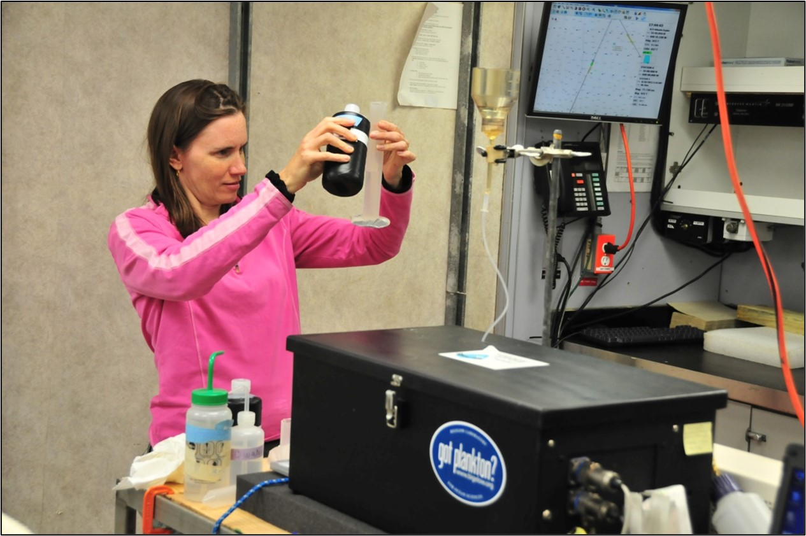
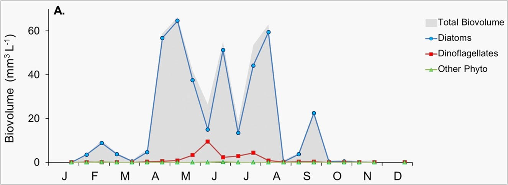
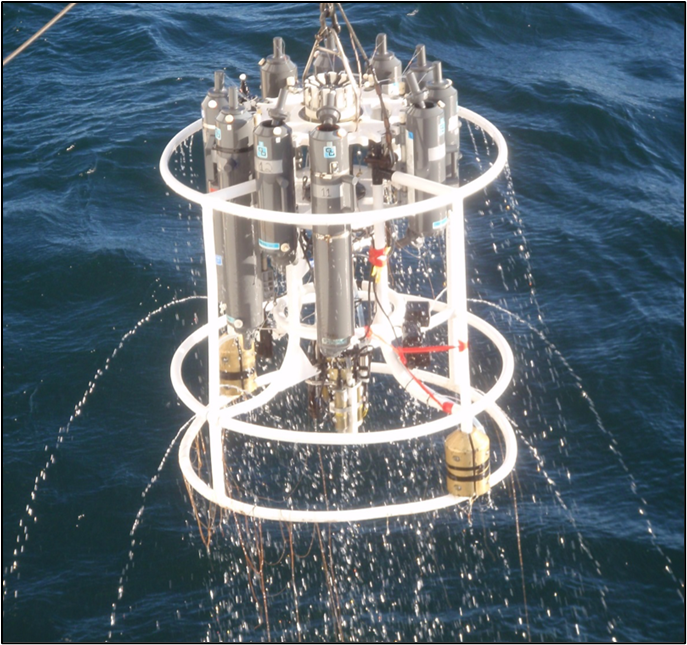

# Manual for Real-Time Quality Control of Phytoplankton Data

A Guide to Quality Control and Quality Assurance for Phytoplankton Observations

<http://doi.org/10.7289/V56D5R6S>

## Acknowledgements

Creation of each U.S. IOOS QARTOD quality control manual relies upon the voluntary participation of many individuals with expertise in the specific variable being addressed. 
We are grateful to our team of contributors and reviewers, 
who either participated in a series of initial teleconferences, 
provided content for the manual, and/or contributed thoughtful and thorough reviews. 
We are also very grateful for the ongoing support provided by the Data Management and Communications community. 
Many of these individuals provide input to a manual and then become responsible for implementing the resulting tests, 
which makes for a more effective arrangement. 
We also greatly appreciate the continued support provided by the QARTOD Board of Advisors; 
their guidance and wisdom ensures the Project remains focused on the proper issues and variables. 
All these individuals are listed in appendix A. 

Finally, 
we wish to express our gratitude in memoriam to our good friend and colleague Vembu Subramanian. 
Vembu was an early and consistent supporter of the QARTOD Project, 
and we will greatly miss his knowledge, 
enthusiasm, 
and humor. 

## Acronyms and Abbreviations

|   |   |
|---|---|
|ACT|Alliance for Coastal Technologies|
|AOOS|Alaska Ocean Observing System|
|AUV|Autonomous Underwater Vehicle|
|CariCOOS|Caribbean Coastal Ocean Observing System|
|CeNCOOS|Central and Northern California Ocean Observing System|
|CRC|Cyclic Redundancy Check|
|CTD|Conductivity, Temperature, and Depth|
|°C|Degrees Celsius|
|DA|Domoic acid|
|DMAC|Data Management and Communications|
|ESP|Environmental Sample Processer|
|FIT|Fluid Imaging Technologies|
|GCOOS|Gulf of Mexico Coastal Ocean Observing System|
|GLOS|Great Lakes Observing System|
|GMT|Greenwich Mean Time|
|GOOS|Global Ocean Observing System|
|HAB|Harmful Algal Bloom|
|IOC|Intergovernmental Oceanographic Commission|
|IOOS|Integrated Ocean Observing System|
|IFCB|Imaging FlowCytobot|
|IVF|In-vivo Fluorometry|
|LOBO|Land/Ocean Biogeochemical Observatory|
|MARACOOS|Mid-Atlantic Regional Association Coastal Ocean Observing System|
|µg/L|Micrograms per Liter|
|µm|Micrometer (micron)|
|mg/L|Milligrams per Liter|
|mL|Milliliters|
|MVCO|Martha's Vineyard Coastal Observatory|
|NANOOS|Northwest Association of Networked Ocean Observing Systems|
|NERACOOS|North Eastern Regional Association of Coastal Ocean Observing Systems|
|NIST|National Institute of Standards and Technology|
|NOAA|National Oceanic and Atmospheric Administration|
|NOS|National Ocean Service|
|OPD|Optical Phytoplankton Discriminator|
|PacIOOS|Pacific Islands Ocean Observing System|
|QARTOD|Quality Assurance / Quality Control of Real-Time Oceanographic Data|
|QA|Quality Assurance|
|QC|Quality Control|
|R/V|Research Vessel|
|SCCOOS|Southern California Coastal Ocean Observing System|
|SD|Standard Deviation|
|SECOORA|Southeast Coastal Ocean Observing Regional Association|
|SEPMN|Southeast Phytoplankton Monitoring Network|
|TOAST|Texas Observatory for Algal Succession Time-Series|
|UNESCO|United Nations Educational, Scientific, and Cultural Organization|
|USGS|United States Geological Survey|
|UTC|Coordinated Universal Time|
|Vdc|Volts Direct Current|

## Definitions of Selected Terms 

This manual contains several terms whose meanings are critical to those using the manual. 
These terms are included in the following table to ensure that the meanings are clearly defined. 

|   |   |
|---|---|
|Codable Instructions|Codable instructions are specific guidance that can be used by a software programmer to design, construct, and implement a test. These instructions also include examples with sample thresholds.|
|Data Record|A data record is one or more messages that form a coherent, logical, and complete observation.|
|Message|A message is a standalone data transmission. A data record can be composed of multiple messages.|
|Flow Cytometry|Flow cytometry is a laser- or impedance-based, biophysical technology employed in cell counting, cell sorting, biomarker detection, and protein engineering by suspending cells in a stream of fluid and passing them by an electronic detection apparatus.|
|Interoperable|Interoperable means the ability of two or more systems to exchange and mutually use data, metadata, information, or system parameters using established protocols or standards.|
|Operational|Operational means routine, guaranteed, and sustained provision of data streams and data products of known quality, in perpetuity or until no longer needed, at rates and in forms specified by user groups regardless of the intended use (operational support or research and development).|
|Operator|Operators are individuals or entities who are responsible for collecting and providing data.|
|Quality Assurance (QA)|QA involves processes that are employed with hardware to support the generation of high quality data (section 2.0 and appendix B).|
|Quality Control (QC)|QC involves follow-on steps that support the delivery of high quality data and requires both automation and human intervention (section 3.0).|
|Real Time|Real time means that: data are delivered without delay for immediate use; time series extends only backwards in time, where the next data point is not available; and sample intervals may range from a few seconds to a few hours or even days, depending upon the sensor configuration (section 1.0).|
|Sensor|A sensor is a device that detects or measures a physical or biological property and provides the result without delay.|
|Threshold|Thresholds are limits that are defined by the operator.|
|Variable|A variable is an observation (or measurement) of biogeochemical properties within oceanographic and/or meteorological environments.|

## 1.0 Background and Introduction

The U.S. Integrated Ocean Observing System (IOOS®) has a vested interest in collecting high-quality data for the 26 core variables (U.S. IOOS 2010) measured on a national scale. 
In response to this interest, U.S. IOOS continues to establish written, 
authoritative procedures for the quality control (QC) of real-time data through the Quality Assurance/Quality Control of Real-Time Oceanographic Data (QARTOD) Project, 
addressing each variable as funding permits. 
This phytoplankton manual is the tenth in a series of guidance documents that address QC of real-time data of each core variable. 

Please refer to <https://ioos.noaa.gov/project/qartod/> for the following documents. 

1. U.S. Integrated Ocean Observing System, 2015. U.S IOOS QARTOD Project Plan - Accomplishments for 2012–2016 and Update for 2017–2021. 47 pp.
2. U.S. Integrated Ocean Observing System, 2015. Manual for Real-Time Quality Control of Dissolved Oxygen Observations Version 2.0: A Guide to Quality Control and Quality Assurance for Dissolved Oxygen Observations in Coastal Oceans. 48 pp. 
3. U.S. Integrated Ocean Observing System, 2015. Manual for Real-Time Quality Control of In-Situ Current Observations Version 2.0: A Guide to Quality Control and Quality Assurance of Acoustic Doppler Current Profiler Observations. 51 pp. 
4. U.S. Integrated Ocean Observing System, 2015. Manual for Real-Time Quality Control of In-Situ Surface Wave Data Version 2.0: A Guide to Quality Control and Quality Assurance of In-Situ Surface Wave Observations. 64 pp. 
5. U.S. Integrated Ocean Observing System, 2015. Manual for Real-Time Quality Control of In-situ Temperature and Salinity Data Version 2.0: A Guide to Quality Control and Quality Assurance of In-situ Temperature and Salinity Observations. 56 pp.
6. U.S. Integrated Ocean Observing System, 2016. Manual for Real-Time Quality Control of Water Level Data Version 2.0: A Guide to Quality Control and Quality Assurance of Water Level Observations. 46 pp.
7. U.S. Integrated Ocean Observing System, 2014. Manual for Real-Time Quality Control of Wind Data: A Guide to Quality Control and Quality Assurance of Coastal and Oceanic Wind Observations. 45 pp. 
8. U.S. Integrated Ocean Observing System, 2015. Manual for Real-Time Quality Control of Ocean Optics Data: A Guide to Quality Control and Quality Assurance of Coastal and Oceanic Optics Observations. 46 pp.
9. U.S. Integrated Ocean Observing System, 2015. Manual for Real-Time Quality Control of Dissolved Nutrients Data: A Guide to Quality Control and Quality Assurance of Coastal and Dissolved Nutrients Observations. 56 pp.
10. U.S. Integrated Ocean Observing System, 2016. Manual for Real-Time Quality Control of High Frequency Radar Surface Currents Data: A Guide to Quality Control and Quality Assurance of High Frequency Radar Surface Currents Data Observations. 58 pp. 

Please reference this document as: 

   U.S. Integrated Ocean Observing System, 2017. Manual for Real-Time Quality Control of Phytoplankton Data: A Guide to Quality Control and Quality Assurance of Phytoplankton Observations. 68 pp. 

This manual is a living document that reflects the state-of-the-art QC testing procedures for phytoplankton observations. 
It is written for the experienced operator but also provides examples for those who are just entering the field. 

## 2.0 Purpose, Constraints, Applications, and Technologies 

The following sections describe the purpose of this manual, 
as well as the constraints that operators may encounter when performing real-time QC of phytoplankton data, 
specific applications of those data, 
and the technologies that enable collection of phytoplankton data. 

### 2.1 Purpose and Scope

The purpose of this manual is to provide guidance to the U.S. IOOS and the ocean-observing community at large for the real-time QC of phytoplankton measurements using an agreed-upon, 
documented, 
and implemented standard process. 
This manual is also a deliverable to the U.S. IOOS Regional Associations and the ocean-observing community and represents a contribution to a collection of core variable QC documents. 

Most operators provide real-time data on a provisional basis, 
alerting users that post-processing is required to validate their data. 
However, 
even these provisional data should be quality controlled. 
Data released in real time should be subjected to automated QC processes, 
which: 1) provide a quality-control indicator, 2) alert the operator when questionable or interesting data are presented, 
and 3) prevent the dissemination of unreliable data. 

These practices for sensor QC of phytoplankton data were developed by operators with experience using a variety of sensors and detection technologies. Traditional observations of phytoplankton are obtained through manual sampling and microscopic examination by specialists. 
Phytoplankton relative abundance can be determined through fluorometric techniques that quantify pigment concentrations as a proxy for biomass. 
Realtime detection of phytoplankton can be accomplished using automated image classification, molecular probes, 
and spectral signature methods in situ or in the lab. 
Such systems draw water samples into a chamber where the measurements occur. 
The process utilizes micro-pumps, 
valves, filters, 
and a variety of detectors and can require considerable maintenance due to their complexity. 
Systems may require frequent calibration of fluid delivery devices (pumps) and replenishment of process components/reagents. 
Post-processing may also be required to improve data accuracy. 

Phytoplankton observations covered by these procedures are collected as a measure of water quality along bays, 
coasts¹, and open oceans in real time. 
These tests draw from existing expertise in programs such as those listed in table 2-1. 

<small>¹ The coast means coasts of the U.S. Exclusive Economic Zone (EEZ) and territorial sea (http://oceanservice.noaa.gov/facts/eez.html) Great Lakes, and semi-enclosed bodies of water and tidal wetlands connected to the coastal ocean.</small>

|   |   |
|---|---|
|**Martha's Vineyard Coastal Observatory**|Heidi Sosik, hsosik@whoi.edu http://www.whoi.edu/mvco  http://www.whoi.edu/science/AOPE/dept/COSMOS/Sosik.pdf  MVCO is located a mile off the south shore of Martha's Vineyard, is operated by Woods Hole Oceanographic Institution, and provides real-time oceanographic and meteorological data.|
|**Florida Atlantic University Land/Ocean Biogeochemical Observatory**|http://fau.loboviz.com/loboviz/ FAU – Harbor Branch Oceanographic Institute operates the LOBO network within the Indian River Lagoon and the St. Lucie Estuary.|
|**Operational Ecological Forecasting of Harmful Algal Blooms (HAB) in the Pacific Northwest**|https://coastalscience.noaa.gov/news/habs/real-time-hab-toxin-sensors-deployed-pacific-northwest An environmental sample processor (ESP) is deployed off the coast of La Push, Washington in the Olympic Coast National Marine Sanctuary. The deployment is part of a collaborative IOOS-funded Ocean Technology Transition project.|
|**Southeast Phytoplankton Monitoring Network**|http://marex.uga.edu/southeast_phytoplankton_monitoring_network|
|**Texas Observatory for Algal Succession Time-Series (TOAST)**|Lisa Campbell,lisacampbell@tamu.edu  http://toast.tamu.edu/IFCB7 http://gcoos.org/products/index.php/bio/hab/  TOAST is located at the University of Texas Marine Science Institute pier in Port Aransas, Texas and provides near real-time phytoplankton abundance data.|
|**Gulf of Maine North Atlantic Time Series (GNATS) (Bigelow Laboratory for Ocean Sciences)**|http://www.int-res.com/abstracts/meps/v450/p11-35|
|**Bigelow Laboratory for Ocean Sciences**|Nicole Poulton,npoulton@bigelow.org|
|**University of Rhode Island**|Francoise Morison,francoisemorison@gmail.com|
|**Columbia University**|Joaquim Goes, jig@ldeo.columbia.edu|
|**Puget Sound Phytoplankton Monitoring Program**|Gabriela Hannach,gabriela.hannach@kingcounty.gov http://green2.kingcounty.gov/marine/Monitoring/Phytoplankton  http://green2.kingcounty.gov/marine-buoy/  http://www.fondriest.com/news/king-county-water-quality-moorings-keep-a-close-eye-on-puget-sound.htm|
|**Mississippi Department of Marine Resources (MDMR) and University of Southern Mississippi (USM)**|Adam Boyette, Adam.Boyette@usm.edu. http://www.dmr.ms.gov Whenever there is a HAB event, USM provides near-real-time FlowCam® cell counts and identification, which are compared to field samples analyzed by MDMR using standard cell count techniques.|
|**California Harmful Algal Bloom Monitoring and Alert Program (CalHABMAP)**|Weekly phytoplankton monitoring reports along the California coast. Overview site for monitoring system, local monitoring contacts accessible from there. http://www.sccoos.org/data/habs|

: Table 2-1. Existing programs with subject matter experts who have extensive expertise in phytoplankton.

This manual may differ from existing QC procedures for phytoplankton measurements in that its focus is on real-time data. 
It presents a series of eleven tests that operators can incorporate into practices and procedures for QC of phytoplankton measurements. 
These tests apply only to real-time interoperable measurements of phytoplankton as observed manually or by sensors deployed on fixed or mobile platforms and not to remotely sensed phytoplankton measurements (e.g., satellite observations). 
Table 2-2 shows types of platforms and areas that are included and excluded in this manual. 
Those excluded are deemed to require substantially different QC tests, 
a different observational community, 
substantially greater resources, 
or they presently lack a realtime data delivery capability. 
Whenever possible, these platforms will be included in later manual updates. 

|Included Platforms and Areas|Excluded Platforms|
|---|---|
|• Buoys • Oil platforms • Surface fixed, profiling, and mobile platforms • Autonomous surface vessels and ships • Autonomous underwater vehicles|• Satellite • Aircraft|

: Table 2-2. Types of platforms included in and excluded from this manual.

### 2.2 Sensor Technology

Phytoplankton observation technologies vary broadly, 
and, 
where necessary, 
they are addressed individually. 
Table 2-3 shows the technologies that are addressed in this manual, 
as well as those that are excluded. 

|Technologies Included in this Manual|Technologies Excluded|
|---|---|
|• Manual sampling/microscopy • Fluorometry observations of chlorophyll-_a_, phycoerythrin, and phycocyanin • Flow cytometry • Imaging flow cytometry • Environmental Sample Processor (ESP) • Optical Phytoplankton Discriminator (OPD)|• Remotely sensed spectroscopy|

: Table 2-3. Examples of phytoplankton observing technologies that are included in or excluded from this manual.

To make phytoplankton observations, 
a variety of sensors and technologies are employed. 
The measurement may observe a surrogate related to phytoplankton, such as the fluorescence of a pigment. 
These relational observations are common within oceanography—for example, 
the most routine method to determine salinity is by measuring conductivity and temperature and then calculating salinity—and an understanding of the inherent limitations of the techniques is required. 

Table 2-4 lists several types of sensors and techniques typically used to observe phytoplankton and phytoplankton surrogates and generate data that could be subjected to the described tests. 
The list is not comprehensive, 
and operators must determine if these tests apply to their specific phytoplankton sensor. 

|Manufacturer/Sensor|Variables Measured|Measuring Principle|
|---|---|---|
|Chelsea|Chlorophyll, phycocyanin, phycoerythrin|In-vivo fluorometry|
|Fluid Imaging Technologies/FlowCam®|Particle imaging and image recognition|Timed or fluorescence-triggered particle imaging|
|McLane Research Laboratories, Inc./IFCB|Particle imaging and automated image recognition|Fluorescence-triggered particle imaging|
|McLane Research Laboratories, Inc./ESP|Species identification|Molecular/DNA|
|Mote Marine Laboratory and Aquarium – Kirkpatrick/OPD|Species-specific relative index|Spectral signature|
|Turner Designs/C6P|Chlorophyll, phycocyanin, phycoerythrin|In-vivo fluorometry|
|WET Labs WETStar, ECO FL, FLBBCD|Chlorophyll, phycoerythrin,|In-vivo fluorometry|
|Xylem-YSI/EXO|Chlorophyll, phycocyanin, phycoerythrin|In-vivo fluorometry|

: Table 2-4. Commonly used sensors for phytoplankton observations. 

#### 2.2.1. Manual sampling/microscopy

Using a microscope, 
the phytoplankton cells are manually counted or estimated from a known volume of seawater. 
Examples of this technique include the Utermöhl method, 
the settlement bottle method, and the counting chamber method for quantitative phytoplankton analysis (IOC 2010). 
Quantitation by microscopy may be fraught with difficulties, unless the laboratory/analysts specifying exactly how samples were collected, what preservation methods were used, 
analytical conditions for pre-concentration and counting criteria for conducting (and terminating) a count etc. 
Additionally, 
knowledge of the level of training and expertise of the analyst and opportunities for regular cross-checking of results are necessary. 

Manual sampling and microscopy are the standards used to validate all other methods; 
if conducted frequently enough, they could be considered real-time observations, 
so operators may be able to utilize the tests described herein. 
Frequent comparison of sensor data with microscopy data should allow microscopy methods to be adjusted (for example if the count methodology does not capture very small cells at the limit of detection). 
If this is done early, 
as well as throughout the monitoring program, 
that should help minimize any data mismatches due to incompatible or uncomparable techniques. 

#### 2.2.2. Fluorometry

In-vivo fluorometry (IVF) has been used for decades to estimate the concentration of phytoplankton (Lorenzen 1966). 
Prior to IVF, 
chlorophyll extraction techniques were the standard (Holm-Hansen et al. 1965). 
In both, excitation at one wavelength creates fluorescence at another with an intensity that is proportional to the quantity of a pigment of interest, 
such as chlorophyll-_a_ in green algae or the phycobilin pigments of cyanobacteria, 
phycocyanin, 
and phycoerythrin. 
Because of its simplicity and nearly instantaneous output, 
IVF is often employed for pumped shipboard or in-situ, 
real-time systems. 
The output provides a relative measure that can be correlated to quantitative cell concentration values (fig. 2-1), 
or the relative measure can be used to observe trends. 

As with all measurements, 
the technique is not without drawbacks. 
Excitation source and detector drift have been greatly reduced recently but may still be an issue as instruments age; 
additionally, temperature, turbidity, 
dissolved components, 
and cell health can cause measurement errors. 
Another important issue can be the nonphotochemical quenching of surface fluorescence values by ambient sunlight — an effect that breaks the linear relationship between chlorophyll fluorescence and chlorophyll-_a_ concentration. 
Correction of this physiological effect is based on the observation that the varying depth of the daytime fluorescence maximum is a good proxy for the depth of the layer potentially affected by non-photochemical quenching. 
The maximum fluorescence value is extrapolated to the surface, 
which is one way to correct for this quenching effect. 

<figcaption>Figure 2-1. Relative observations of fluorescence can be quantified through a correlation with cell concentrations. (Image courtesy of Turner Designs)</figcaption>

#### 2.2.3. Spectrophotometry/Optical Phytoplankton Discriminator 

Optical phytoplankton discriminator (OPD) systems estimate quantities of a specific phytoplankton species or group (e.g., diatoms, dinoflagellates, etc.) using optical absorbance characteristics of particles in the water (Shapiro et al. 2015). 
Species-specific detection relies on the presence of a unique pigment whose spectral signature is distinct from those comprising the ambient phytoplankton assemblage. 
Sea water is pumped through a liquid waveguide capillary cell, 
illuminated, 
and the resultant light transmission spectrum provides a measure of cell abundance (Kirkpatrick et al. 2000). 

#### 2.2.4. Imaging Flow Cytometry

The Imaging FlowCytobot (IFCB) and the FlowCam® are flow cytometers that combine a camera and a traditional flow cytometer. 
They are imaging-in-flow instruments that combine high-resolution imaging and flow cytometer technology to capture phytoplankton images. 
The chlorophyll fluorescence emitted from phytoplankton cells is used to trigger the camera, capturing images of organisms from approximately 10 µm to over 100 µm. 

**_Imaging FlowCytobot_** 

The IFCB, available from McLane Research Laboratories, Inc. (East Falmouth, Mass.), 
is an in-situ automated submersible flow cytometer that is designed for continuous sampling and processing for measuring phytoplankton abundance (Olson and Sosik 2007). 
Laser-induced fluorescence and light scattering from individual particles are measured and used to trigger targeted image acquisition; 
the optical and image data are then transmitted to shore in real time (fig. 2-2 shows an example of the dashboard view). 
Continuous sampling at a rate of 15 mL of seawater per hour can generate approximately 30,000 images per hour, 
depending on the target population. 
The high-resolution images (~3.4 pixels/micron) are processed externally with automated image classification software (Sosik and Olson 2007; Harred and Campbell 2014). 
A supervised random forest algorithm is used to classify images (often to genus or species, 
with demonstrated accuracy comparable to that of human experts). 
Classification results are then used to provide near-real-time estimates of taxon-specific cell abundance and biomass. 
The resulting time series delivers data at a frequency sufficient for early warning of harmful algal blooms (fig. 2-3). 

<figcaption>Figure 2-2. Daily near real-time phytoplankton images from TOAST. (Image courtesy of Dr. Lisa Campbell, <http://toast.tamu.edu/IFCB7>)</figcaption>

<figcaption>Figure 2-3. Example of time series plot provided by TOAST for HAB early warning.</figcaption>

**_FlowCam_** 

Fluid Imaging Technologies (FIT), 
based in Scarborough, Maine, offers several types of imaging particle analyzers to quantify and classify phytoplankton, 
including the FlowCam, 
which combines a flow cytometer and microscope. Visualspreadsheet®, 
FIT’s proprietary software, quantifies over 40 different particle properties from the FlowCam images, 
and these properties can be sorted based on their attributes. 
In addition, Visualspreadsheet’s particle recognition capabilities, Classifier Advanced®, 
can be used for classifying organisms, cells, 
and particles of interest semi-automatically using two different machine learning algorithms, 
Support Vector Machine and Normal Bayes. 
The FlowCam VS series and 8000 series use a combination of imaging and laser light to detect and image particles within a fluid stream at different magnifications and can image particles from 2µm–5mm (Poulton 2016). 
Other FlowCam features can include: color or black and white high-speed cameras; 
autofocus assemblies to assist in accurate and repeatable depth-of-field focusing; 
cross-polarization lenses; 
and the option for varying the laser (blue or green) and fluorescence emission filters for capture of chlorophyll, 
phycoerythrin, 
or fluorescein isothiocyanate. 

The FlowCam was developed at Bigelow Laboratory for Ocean Sciences. 
Since its introduction to the oceanographic community in 1999, 
over 300 instruments have been installed in over 50 countries for aquatic research and monitoring. 
The FlowCam has been employed as a field-based technology to assist in satellitebased phytoplankton population monitoring and mapping (Coley 2016), 
which is why this technology is included in this QARTOD manual. 
An example of imagery from a FlowCam is shown in fig. 2-4. 

<figcaption>Figure 2-4. A collection of FlowCam images from Adam Boyette, Adam.Boyette@usm.edu.</figcaption>

The traditional methods for collecting discrete and accurate concentrations of picophytoplankton and mixed populations of ultraphytoplankton include fluorescence microscopy and shipboard flow cytometry (Verity and Sieracki 1993; Olson et al. 1985); 
however, 
these methods have several disadvantages. 
As previously noted, 
microscopy can be time-intensive and image recognition may require a highly skilled technician. 
Flow cytometry is a rapid, 
high-throughput method but does not include images to assist in classifying populations. 
In contrast, 
FlowCam is a continuous imaging flow cytometer and particle analyzer designed for conducting research and monitoring microorganisms and particles in both marine and freshwater systems. 
Sampling time is a consideration for ground-validating, 
real-time phytoplankton populations in situ. 
The FlowCam’s Visualspreadsheet can remotely and continuously collect and analyze discrete samples without a technician operating the instrument. 

Two direct underway systems (impeller pump system and diaphragm pump system) were compared to assess particle size distribution during the AE1319 cruise aboard R/V Atlantic Explorer (fig. 2-5) spanning Nova Scotia, 
Newfoundland, 
Canada to the Labrador Sea (Cetinic et al. 2016). 
These measurements are critical for algorithm development and validation of satellite data. 
The FlowCam was used to assess nano/microphytoplankton biomass calculated from biovolume measurements. 

<figcaption>Figure 2-5. Dr. Nicole Poulton from Bigelow Laboratory for Ocean Sciences aboard AE1319 cruise aboard the R/V Atlantic Explorer uses one of the older FlowCam models for data collected in August 2013. (Photo by Wayne H. Slade and courtesy of FIT)</figcaption>

King County, 
Washington conducts extensive marine phytoplankton observations as part of a long-term Puget Sound ambient monitoring program. 
Both microscopy and FlowCam analysis are conducted every two weeks for eight stations in the central basin. 
Figure 2-6 shows processed FlowCam data, 
depicting the seasonal variation in biovolume for the Puget Sound Central Basin. 
The plot indicates that greater variability occurs in the summer months, 
and automated, 
real-time QC tests might adjust seasonal thresholds to accommodate these fluctuations. 

<figcaption>Figure 2-6. Seasonal variation in total biovolume found in Puget Sound Central Basin. (Graphic courtesy of Dr. Gabriela Hannach/King County, Washington)</figcaption>

#### 2.2.5. Molecular/Environmental Sample Processor

The Environmental Sample Processor (ESP) collects in-situ water samples and utilizes molecular probes to identify microorganisms and their gene products (Scholin et al. 2009). 

Data generated are then available for remote retrieval and analysis in near real-time. 
Table 2-5 provides an overview of the sensor specifications. 

The system is a modular design consisting of a core sample processor (the ESP), 
analytical modules, 
and sampling modules. 
In addition to the core processor, 
an optional ‘PCR module’ is also available that allows for parallel processing of collected samples. 
The core ESP provides the primary interface between the environment and a set of ribosomal RNA (rRNA), 
DNA, 
and antibody-based sample processing technologies that are applied onboard the instrument in real time (Greenfield et al. 2008; Doucette et al. 2009). 
In addition, 
the ESP can be used to archive samples for a variety of analyses after the instrument is returned to a laboratory. 
Phytotoxin measurements can also be done on the ESP via enzyme-linked immunosorbent assay (ELISA). 
This has mostly been applied to measuring the neurotoxin domoic acid (DA.) 

Nucleic acid probes for these organisms are available for use with the Sandwich Hybridization Assay or SHA chemistry on the ESP: _Pseudo-nitzschia australis_, 
_Pseudo-nitzschia multiseries_ / _pseudodelicatissima_, 
_Pseudo-nitzschia pungens_, 
_Alexandrium catenella_, 
_Heterosigma akashiwo_, 
numerous _Karenia_ spp., 
and _Cochlodinium polykrikoides_. 

Present ESP operations are limited to a relatively small set of samples which do not impose a large QC challenge and observations are best tested manually. 
As this technology continues to emerge it is expected that the QC tests described here will begin to appeal to operators of the ESP. 

|Assay methods|Sandwich hybridization (SHA), Polymerase Chain Reaction (PCR), and immunosorbent assays (cELISA)|
|---|---|
|Puck capacity|132 pucks (archive only; or 22 HAB/DA array phases)|
|Depth|Maximum depth of 50 m with addition of surface ESPpressure housing|
|Temperature rating|4 °C to 29 °C (depending on reagents deployed)|
|Max deployment time|6 months(dependingonpower source)|
|Power|10 – 16 Vdc|

: Table 2-5. Overview of ESP specifications.

### 2.3 Constraints

Exciting emerging technologies such as the IFCB and the ESP have not yet achieved data interoperability as defined herein. 
They are described and included in this manual in the hope that the QC concepts of the QARTOD Project will be considered, 
to help to guide the future creation of interoperable data products that are quality controlled using community-developed standards that will be documented when this manual is updated. 

#### 2.3.1. Data Processing Methodology

The type of sensor system used to collect phytoplankton data and the system used to process and transmit the measurements determine which QC algorithms are used. 
In-situ systems with sufficient onboard processing power within the sensor may substantially process the data to produce derived products, such as biovolume, 
abundance of specific taxa, 
and relative chlorophyll abundance observations. 
Some sensors may sample at high-rate or burst mode (e.g., 1 Hz). 
These samples are averaged to produce the actual, 
real-time value transmitted (e.g., hourly value). 
Statistical information about the high-rate sample distributions can also be used and transmitted as real-time QC parameters (e.g., sample standard deviations and outliers). 
If sufficient transmission capability is available, 
expanded data streams may be transmitted ashore and subsequently quality controlled from there. 

When onboard processing is used to reduce high-frequency sampling, 
apply associated corrections, 
and generate the resultant observation to be transmitted, 
operators should have a full understanding of the algorithms employed. 
These processes are often proprietary, 
and when not fully revealed by the manufacturer or vendor, 
the operator should sufficiently test the system to gain the needed understanding. 

#### 2.3.2. Traceability to Accepted Standards

To ensure that phytoplankton sensors produce accurate data, 
rigorous calibrations and calibration checks must be performed in addition to QC checks. 
Most operators rely upon manufacturer calibrations and may conduct calibration checks before deployment. 
These calibration checks are critical to ensuring that the manufacturer calibration is still valid. 
Manufacturers describe how to conduct these calibration checks in their user manuals, 
which are currently considered QA and further addressed in appendix B. 

Calibrations and calibration checks must be traceable to accepted standards. 
NIST, 
a provider of internationally accepted standards, 
is often the source for these standards (http://www.nist.gov/index.html). 
Calibration activities must be tailored to match data use and resources. 
Calibration cost and effort increase dramatically as accuracy requirements increase. 
Fundamental NIST standards such as mass and volume may be required when conducting calibration checks on phytoplankton sensors. 

Manufacturers and/or vendors often provide calibration standards. 
For example, 
Turner Designs (http://www.turnerdesigns.com/products/fluorometer-primary-calibration-standards) offers fluorometric and spectrophotometric chlorophyll-_a_ standards. 
Algal strains are available from the Bigelow National Center for Marine Algae and Microbiota (https://ncma.bigelow.org/products/algae/marine), 
enabling assessment of sensor response factors for a range of taxa when required.

Where NIST or manufacturer standards are not available, 
an active research effort generally exists among operators and manufacturers regarding the use of primary and secondary standards for instrument calibration and calibration checks. 

#### 2.3.3. The Effect of Dynamic Environments on Phytoplankton Measurements 

Phytoplankton measurements can be challenging for two reasons: Phytoplankton density is a nonconservative² variable, 
and dynamic coastal regions create rapid horizontal and vertical water mass changes. 
Tidal and meteorological events can create substantial steps in the phytoplankton time series. 
Physiological variability adds additional complexity to fluorescence-based estimates of living phytoplankton biomass, 
since fluorescence yield varies by taxa, 
time of day, etc. 
Other variations are induced by such things as seasonal stratification, 
upwelling, 
organic loading, increased biological activity (blooms), 
air-sea exchange, 
river inputs, 
spawning aggregations, 
fish kills (indeed, all biological activities), 
sediment-water exchange, 
groundwater seepage, 
and springs. 

As with many other real-time QC challenges, 
the question is how to deal with extremes associated with a phenomenon (e.g., blooms, storm runoff, etc.) in a data time series, 
yet identify questionable data values that may have similar characteristics. 
One option is to allow a tighter QC requirement for the data, 
highlighting the event with a suspect flag and requiring a human review. 
This way, 
the event is both: a) acknowledged as substantial if real, 
and b) identified as potentially questionable in the absence of causal forces. 
Also, 
concurrent sensing of turbidity proxies provides additional context for interpretation of data spikes in realtime data streams. 

The effects of bio-fouling also must be considered. 
Bio-fouling varies seasonally and geographically and can often be the limiting factor in determining the deployment duration. 
Bio-fouling can manifest itself as either a systematic increase or decrease in signal. 
Phytoplankton sensing systems have components that must remain free of contamination, 
or they will create errors as growth accumulates. 
Phytoplankton sensors that draw in a water sample for analysis must properly filter the input sample to avoid clogging, 
and the filter itself must remain free of growth. 

<small>² Temperature and salinity are examples of conservative properties because there are no sources or sinks of heat and salt in the interior of the ocean. Other properties, such as oxygen are non-conservative. For example, oxygen content may change slowly due to oxidation of organic material and respiration by animals. See http://www.utdallas.edu/~pujana/oceans/sali.html.</small>

#### 2.3.4. Sensor Deployment Considerations and Hardware Limitations 

Phytoplankton sensors can be deployed in several ways. Stationary sensor deployments are on fixed platforms or moorings where there is minimal movement either horizontally or vertically. Alternatively, sensors may be lowered from a ship, deployed aboard autonomous surface or underwater vehicles, or installed on moored or drifting buoys. The typical constraints of oceanographic data collection apply—including cost, power, data transmission, bio-fouling, vandalism, and electronics in a marine environment. Examples of these deployment options are shown in fig. 2-7.

<figcaption>Figure 2-7. Upper left shows a fixed structure on the Mississippi River at Baton Rouge, where the instrument cage is lowered and raised. Upper right shows a NexSens buoy supporting a variety of water quality instruments. Bottom figure shows a Seabird electronics 9-11 CTD equipped with a variety of auxiliary sensors, a rosette, and Niskin bottles being retrieved from the R/V Oscar Dyson during a NOAA (BASIS) cruise in 2012. (Upper photos courtesy of Dr. Brian Pellerin/USGS. Lower photo courtesy of Jeanette Gann/NOAA.)</figcaption>

Mobile platforms are available in a variety of configurations and require different real-time phytoplankton QC considerations. 
Mobile platforms are, in order of increasing data processing complexity: fixed vertical profilers, 
mobile surface vessels, 
and vessels freely operating in three dimensions (e.g., gliders, floats, powered autonomous underwater vehicles or AUVs). 
Figure 2-8 provides examples of mobile platforms.

<figcaption>Figure 2-8. WebbGlider Profiler 3-D (L) (photo courtesy of Dr. Grace Saba) and Liquid Robotics Wave Glider Mobile Surface (R) (photo courtesy of Liquid Robotics).</figcaption>

Data derived from sensors on moving platforms are constrained by the response time of the sensor, 
i.e., 
the time it takes for a technology to respond to a step change in the measured variable. 
These limitations occur in most sensor technology. 

Spatial and temporal resolution require a clear understanding of sensor response time, 
sample rate of the instrument (and in some cases the average period per measurement, if one exists), 
and the vehicle speed. 
The response time will often limit the realized resolution of an instrument. 
For example, 
a sensor with a response time of 60 seconds, 
sampling at 1 Hz and moving through the water at 25 knots will not yield accurate map conditions. 
Generally, 
dynamic errors in moving platform data complicate QA/QC actions for real-time data. 
Operators must understand the magnitude of these errors before setting QA/QC limits on data. 

**_Fixed, In-Situ Vertical Profilers_** 

Fixed, 
vertical phytoplankton profiles can be obtained from a variety of systems, 
including rigid-mounted profiling systems, 
buoy/mooring climbers, 
surface or bottom tethered systems, 
or even routine repeated manual station occupations. 
In such cases, 
the tests described for a fixed sensor (see section 3.3.1) either remain unchanged or are conducted along the vertical ‘z’ axis, 
as well as along a time series of observations. 

**_Mobile Surface Vessels_** 

Examples of mobile surface vessels include human-operated vessels of opportunity and autonomously operated vehicles such as the Liquid Robotics Wave Glider fitted with phytoplankton sensors. 
Samples are obtained at a fixed depth along a defined track, and water may be sampled at fixed temporal or spatial intervals. 
Again, 
the tests described for a fixed sensor may remain unchanged, 
or they are conducted along the vessel track (s) or projections onto longitude (x) and latitude (y) coordinates, 
as well as along a time series of observations.

**_3-D Profiler Vessels_** 

Gliders, 
floats, 
and powered AUVs can provide phytoplankton observations in a wide variety of space/time configurations. 
They can be as simple as along track ‘s’ observations, 
periodic vertical ascent profiles recorded following at-depth drifts (Argo profilers), 
or real-time processed down/up profiles (gliders). 
When applying increasingly complex real-time QC tests to increasingly complex deployments, challenges will arise. 
However, 
most of the eleven tests described in section 3.3 can be applied with little modification. 

**_Instrumentation/Techniques_** 

Phytoplankton instrumentation can be constructed as a single-function device, 
but can also be housed and commingled with additional sensors to form a multi-variable sensing package. 
To make the most meaningful phytoplankton observations, 
operators often co-locate a wide variety of contextual sensors such as pressure, 
temperature, 
salinity/conductivity, 
and nutrients. 

Steps in a time series during a calibration, 
sensor swap, 
or cleaning can be highly dependent on both the site and season and provide valuable information for future service intervals. 
Correcting such a data shift is extremely difficult, 
so servicing schedules and the technology used should be carefully considered. 
Constant improvements in anti-fouling measures and sensor technology stability are being made. 
Operators should investigate which technology best suits their application, 
the field service budget, and data quality goals. 

While outside the scope of the real-time tests described in this manual, 
quality assurance is critical to data quality. 
Sensors require attention to proper QA measures both before and after the deployment. 
Operators must follow the manufacturer’s recommendations for factory calibration schedules and proper sensor maintenance. 
Often, operators take field samples during deployment, 
recovery, 
or service to validate the performance of an in-situ sensor. 
This can be a risky time for ensuring quality sensor data, 
often due to initial stabilization, 
sensor/environment disturbance, 
or high fouling near the end. 
If resources permit, 
it is recommended that samples be obtained mid-deployment without disturbing the sensor, 
in coordination with the instrument’s normal sampling period and sampling the same water mass as the instrument encounters. 

Also important, 
but beyond the scope of this document at present, 
is the determination and reporting of data uncertainty. 
Knowledge of the accuracy of each observation is required to ensure that data are used appropriately and aids in the computation of error bounds for subsequent products derived by users. 
All sensors and measurements contain errors that are determined by hardware quality, 
methods of operation, 
and data processing techniques. 
Operators should routinely provide a quantitative measure of data uncertainty in the associated metadata. 
Such calculations can be challenging, 
so operators should also document the methods used to compute the uncertainty. 
The limits and thresholds implemented by operators for the data QC tests described here are a key component in establishing the observational error bounds. 
Operators are strongly encouraged to consider the impact of the QC tests on data uncertainty, 
as these two efforts greatly enhance the utility of their data. 

Sensor redundancy is key to obtaining measurements and ensuring that uncertainties can be assigned to those measurements. 
Comparing two adjacent instruments can assist in evaluation of data quality, 
as well as provide two (or more) independent estimates of a variable of interest. 
Variation in the estimated values can be useful in uncertainty calculations. 

### 2.4 Applications

Real-time observations of phytoplankton are important for a wide variety of applications, 
including: 

- Monitoring for fisheries closures
- Conducting satellite ground-truth
- Implementing on-the-fly course corrections for predictive models 
- Monitoring and early warning for harmful algal blooms
- Determining aquaculture, recreational, and potable water source quality
- Conducting phytoplankton research, including long-term time-series analysis, to monitor environmental impacts of climate variability

Operational HAB modeling systems benefit from real-time information, 
many of which can be found on the NOAA Harmful Algal Bloom Operational Forecast System website <https://www.tidesandcurrents.noaa.gov/hab.> 

Other applications utilizing post-processed data do not require real-time QC but benefit from it through early detection of phytoplankton sensors’ issues. 
Some examples of observatories that benefit from standardized real-time QC testing include: 

- Florida Atlantic University Harbor Branch Indian River Lagoon Observatory, <http://fau.loboviz.com/>
- Sanibel-Captiva Conservation Foundation River, Estuary and Coastal Observing Network (RECON), <http://recon.sccf.org/>

## 3.0 Quality Control

To conduct real-time QC on phytoplankton observations, 
the first pre-requisite is to understand the science and context within which the measurements are being conducted. 
Phytoplankton measurements are dependent upon many things such as season, 
location, 
time of day, 
and the physical, 
chemical, 
and biological conditions where the measurements are being taken. 
The real-time QC of these observations can be extremely challenging. 
Human involvement is important to ensure that solid scientific principles are applied to the process. 
Without credible science-based analysis, 
valid data might be discarded and bad data distributed. 
It is also important to note that advances in phytoplankton sensor technology have reduced many of the problems encountered in older devices. 
Unique species identification techniques, 
specifically image recognition and molecular methods, 
reduce or eliminate the need to quantify relative measurements of observed surrogates. 

This manual focuses specifically on real-time data, 
so the operator is likely to encounter aspects of data QC where the flags and tests described in the following sections do not apply because the data are not considered to be real time. 
For example, for real-time QC, 
drift cannot be detected or corrected. 
Drift correction for phytoplankton sensors during post-processing of data is difficult even with a post-calibration because drift in phytoplankton sensors is not always linear. 
Drift is often caused by bio-fouling, and, in the case of absorption meters and fluorometers, 
typically results in increased signals. 
Another example might be the ability of some data providers to backfill data gaps. 
In both examples, 
the observations are not considered to be real time for purposes of QC checks. 

These QC test procedures are written as a high-level narrative from which operators can develop code to execute specific tests and set data quality indicators (QC flags) within a software program. 
Those implementing QARTOD tests have created a code repository (https://github.com/ioos/qartod) where operators may find or post examples of code in use. Although certain tests are recommended, 
thresholds can vary among data providers. 
The tests described here are designed to support a range of phytoplankton sensors and operator capabilities. 
Some well-established programs with the highest standards, 
such as Florida Atlantic University's land/ocean biogeochemical observatory network and Monterey Bay Aquarium Research Institute’s Monterey Accelerated Research System, 
have implemented very rigorous QC processes. 
Others, 
with different requirements, 
may utilize sensors with data streams that cannot support as many QC checks— all have value when used prudently. 
It is the responsibility of the users to understand and appropriately utilize data of varying quality, 
and operators must provide support by documenting and publishing their QC processes. 
A balance must be struck between the time-sensitive needs of real-time observing systems and the degree of rigor that has been applied to non-real-time systems by operators with substantial QC experience. 
To accommodate a range of different operator methodologies, 
three levels of QC are proposed: 
required, 
strongly recommended, 
and suggested. 

High-quality marine and freshwater observations require sustained QA and QC practices to ensure credibility and value to operators and data users. 
QA practices involve processes that are employed with hardware to support the generation of high-quality data, 
such as a sufficiently accurate, precise, 
and reliable sensor with adequate resolution. Other QA practices include: sensor calibration; 
calibration checks and/or in-situ verification, 
including post-deployment calibration; proper deployment considerations, 
such as measures for corrosion control and anti-fouling; 
solid data communications; 
adequate maintenance intervals; 
and creation of a robust quality control process. 
QA issues, 
such as post-deployment calibration (instrument verification after recovery), 
are not part of the scope of this manual. 
However, 
QC and QA are interrelated and both are important to the process; 
therefore, 
QA considerations are briefly addressed in appendix B. 

QC involves steps that support the delivery of high-quality data and requires both automation and human intervention. 
QC practices include such things as format, 
checksum, 
timely arrival of data, 
threshold checks (minimum/maximum rate of change), 
neighbor checks, 
climatology checks, 
model comparisons, 
signal/noise ratios, 
verification of user satisfaction, 
and generation of data flags (Bushnell 2005). 

The process of ensuring data quality is not always straightforward. 
QA/QC procedures may be specific to a sensor technology or even to a specific manufacturer’s model, 
so the establishment of a methodology that is applicable to every sensor is challenging. 

### 3.1 QC Flags

Data are evaluated using QC tests, and the results of each test are indicated using flags in the data files. 
Table 3-1 provides the set of flags and associated descriptions proposed by the International Oceanographic Data and Information Exchange (IODE) and adopted by the Intergovernmental Oceanographic Commission (IOC) in 2013. 
Operators may incorporate additional flags for inclusion in metadata records. 
For example, 
a phytoplankton observation may fail the gross range test and be flagged as having failed the test. 
Additional flags may be incorporated to provide more detailed information to assist with troubleshooting. 
If the data failed the gross range check by exceeding the upper limit, 
“failed high” may indicate that the values were higher than the expected range, 
but such detailed flags primarily support maintenance efforts and are presently beyond U.S. IOOS requirements for QC of real-time data. 

Flags set in real time should retain their original settings. 
Further post-processing of the data may yield different conclusions from those suggested in the initial real-time flags. 
However, 
by retaining the real-time flag settings, 
the historical documentation is preserved. 
The exception to the rule occurs for the test 6 spike check, 
where the most recent point must be flagged as “2 Not Evaluated” until the next point arrives and the spike check can be performed. 

Additional information regarding the application of data QC flags can be found in U.S. IOOS 2014. 

|Flag|Description|
|---|---|
|Pass=1|Data have passed critical real-time quality control tests and are deemed adequate for use as preliminary data.|
|Not Evaluated=2|Data have not been QC-tested, or the information on quality is not available.|
|Suspect or Of High Interest=3|Data are considered to be either suspect or of high interest to data providers and users. They are flagged suspect to draw further attention to them by operators.|
|Fail=4|Data are considered to have failed one or more critical real-time QC checks. If they are disseminated at all, it should be readily apparent that they are not of acceptable quality.|
|Missing Data=9|Data are missing; used as a placeholder.|

: Table 3-1. Flags for real-time data (UNESCO 2013) 

### 3.2 Test Hierarchy 

This section outlines the eleven real-time QC tests that are required or recommended for selected phytoplankton sensors. 
Tests are listed in order of increasing complexity, 
and generally, 
decreasing utility and are divided into three groups. 
The tests in group 1 are required for all phytoplankton data measurements collected for U.S. IOOS. 
Operators must consider each test in group 2 and group 3 to determine if it can be applied in their specific instance—not all tests can be implemented in all situations. 
Table 3-2 shows the test hierarchy. 

|   |   |   |
|---|---|---|
|**Group 1** _Required_|Test 1 Test 2 Test 3 Test 4|Gap Test Syntax Test Location Test Gross Range Test|
|**Group 2** _Strongly Recommended_|Test 5 Test 6 Test 7 Test 8|Climatological Test Spike Test Rate of Change Test Flat Line Test|
|**Group 3** _Suggested_|Test 9 Test 10 Test 11|Multi-Variate Test Attenuated Signal Test Neighbor Test|

: Table 3-2. QC Tests in order of implementation

Some effort will be needed to select the best thresholds, 
which are determined at the local level and may require trial and error/iteration before final selections are made. 
This manual does not provide overly generic guidance for selecting thresholds because doing so may not yield a good starting point at the local level. 
Although more tests imply a more robust QC effort, 
valid reasons may exist for not invoking a specific test in some instances. 
Where a test from group 2 or group 3 cannot be implemented, 
the operator should document the reason it does not apply. 
The number of tests conducted, 
together with the justification for not applying some tests, 
can be used for the development of operator certification levels. 

### 3.3 QC Tests

A variety of tests can be performed on the data to indicate data quality. 
Testing the integrity of the data transmission itself using a gap test and syntax test is a first step. 
If the data transmission is not sound, 
further testing is irrelevant. 
Additional checks evaluate the phytoplankton core variable values themselves through various comparisons to the data stream and to the expected conditions in the given environment. 
The tests listed in the following section presume a time-ordered series of observations and denote the most recent generic phytoplankton observation (for example, chlorophyll-_a_ or phycobilin pigments, total cell counts, or species-specific cell counts) as PPₙ, preceded by a value of PPₙ₋₁, 
and so on backwards in time. 
The focus is primarily on the real-time QC of observation PPₙ, PPₙ₋₁, and PPₙ₋₂. 
There are several instances when tests are closely related, e.g., 
the climatology test is similar to the gross range test, 
the multi-variate test can be similar to the rate of change test, 
etc. 
As such, 
there are opportunities for clever and efficient coding, 
which are left to the programmers.

#### 3.3.1. Applications of QC Tests to Stationary Phytoplankton Sensors

These eleven tests require operators to select a variety of thresholds. 
These thresholds should not be determined arbitrarily but can be based on historical knowledge or statistics derived from more recently acquired data. 
Operators must document the reasons and methods used to determine the thresholds. 
Examples are provided in the following test tables; 
however, 
operators are in the best position to determine the appropriate thresholds for their operations. 
Some tests rely on multiple data points most recently received to determine the quality of the current data point. 
When this series of data points reveals that the entire group fails, the current data point is flagged, 
but the previous flags are not changed. 
This action supports the view that historical flags are not altered. The first example is in test 8, 
the flat line test, 
where this scenario will become clearer. 
For additional information regarding flags, see the _Manual for the Use of Real-Time Oceanographic Data Quality Control Flags_ (U.S. IOOS 2014) posted on the U.S. IOOS QARTOD website.

**Test 1 - Gap Test (Required)**

Check for arrival of data. 
Test determines that the most recent data point has been received within the expected time window (`TIM_INC`) and has the correct time stamp (`TIM_STMP`). 
**Note:** For those systems that do not update at regular intervals, a large value for `TIM_STMP` can be assigned. The gap check is not a panacea for all timing errors. Data could arrive earlier than expected. This test does not address all clock drift/jump issues. 

|Flags|Condition|Codable Instructions|
|---|---|---|
|Fail=4|Data have not arrived as expected.|`NOW` – `TIM_STMP` > `TIM_INC`|
|Suspect=3|N/A|N/A|
|Pass=1|Applies for test pass condition.|N/A|

Test Exception: None.

Test specifications to be established locally by operator.

Example: TIM_INC= 1 hour

**Test 2 - Syntax Test (Required)** 

Check to ensure that the message is structured properly.
Received data record contains the proper structure without any indicators of flawed transmission such as parity errors. 
Possible tests are: a) the expected number of characters (`NCHAR`) for fixed length messages equals the number of characters received (`REC_CHAR`), 
or b) passes a standard parity bit check, 
CRC check, etc. 
Many such syntax tests exist, 
and the user should select the best criteria for one or more syntax tests. 

**Note:** Capabilities for dealing with flawed messages vary among operators; some can parse messages to extract data within the flawed message sentence before the flaw. Syntax check is performed only at the message level and not at the sub-message level. 

|Flags|Condition|Codable Instructions|
|---|---|---|
|Fail=4|Data record cannot be parsed.|`REC_CHAR` ≠ `NCHAR`|
|Suspect =3|Data record can be partially parsed.|`REC_CHAR` ≠ `NCHAR`, but portion of record decodes successfully|
|Pass=1|Expected data record received; absence of parity errors.|N/A|

Test Exception: None.

Test specifications to be established locally by operator.

Example: `NCHAR` = 128.

**Test 3 - Location Test (Required)** 

Check for reasonable geographic location. 
Test checks that the reported present physical location (latitude/longitude) is within operator-determined limits. 
The location test(s) can vary from a simple invalid location to a more complex check for displacement (DISP) exceeding a distance limit (RANGEMAX) based upon a previous location and platform speed. 
Operators may also check for erroneous locations based upon other criteria, 
such as reported positions over land, as appropriate. 

|Flags|Condition|Codable Instructions|
|---|---|---|
|Fail=4|Invalid location.|If \|LAT\| > 90 or \|LONG\| > 180, flag = 4|
|Suspect=3|Unlikely platform displacement.|If `DISP` > `RANGEMAX`, flag = 3|
|Pass=1|Applies for test pass condition.|N/A|

Test Exception: Test does not apply to fixed deployments when no location is transmitted.

Test specifications to be established locally by operator.

Example: Displacement DISP calculated between sequential position reports, `RANGEMAX` = 20 km.

**Test 4 - Gross Range Test (Required)** 

Data point exceeds sensor or operator selected min/max.

All sensors have a limited output range, and this can form the most rudimentary gross range check. 
No values less than a minimum value or greater than the maximum value the sensor can output (`PP_SENSOR_MIN`, `PP_SENSOR_MAX`) are acceptable. 
Additionally, 
the operator can select a smaller span (`PP_USER_MIN`, `PP_USER_MAX`) based upon local knowledge or a desire to draw attention to extreme values. 

|Flags|Condition|Codable Instructions|
|---|---|---|
|Fail=4|Reported value is outside of sensor span.|`PPₙ` < `PP_SENSOR_MIN`, or `PPₙ`> `PP_SENSOR_MAX`|
|Suspect=3|Reported value is outside of user-selected span.|`PPₙ` < `PP_USER_MIN`, or `PPₙ` > `PP_USER_MAX`|
|Pass=1|Applies for test pass condition.|N/A|

Test Exception: None.

Test specifications to be established locally by operator.

Example: 
`PP_SENSOR_MAX` = 400 µg/L (limited by the character output field, for example) 
`PP_SENSOR_MIN` = 0 µg/L 
`PP_USER_MAX` = 100 µg/L 
`PP_USER_MIN` = 1µg/L

**Test 5 - Climatology Test (Strongly Recommended)** 

Test that data point falls within seasonal expectations.
This test is a variation on the gross range check, 
where the gross range `PP_Season_MAX` and `PP_Season_MIN` are adjusted monthly, 
seasonally, 
or at some other operator-selected time period (`TIM_TST`). 
Expertise of the local user is required to determine reasonable seasonal averages. 
Longer time series permit more refined identification of appropriate thresholds. 

|Flags|Condition|Codable Instructions|
|---|---|---|
|Fail=4|Because of the dynamic nature of `PP`, no fail flag is identified for this test.|N/A|
|Suspect=3|Reported value is outside of user-identified climatology window.|`PPₙ` < `PP_Season_MIN` or `PPₙ` > `PP_Season_MAX`|
|Pass=1|Applies for test pass condition.|N/A|

Test Exception: None.

Test specifications to be established locally by operator: A seasonal matrix of `PPₘₐₓ` and `PPₘᵢₙ` values at all `TIM_TST` intervals.

Examples: `PP_WINTER_MIN` = 1 µg/L `PP_WINTER_MAX` = 50 µg/L.

**Test 6 - Spike Test (Strongly Recommended)** 

Data point n-1 exceeds a selected threshold relative to adjacent data points.
This check is for single value spikes, 
specifically the PP value at point n-1 (`PP₍ₙ₋₁₎`). 
Spikes consisting of more than one data point are notoriously difficult to capture, 
but their onset may be flagged by the rate of change test. 
This spike test example consists of two operator-selected thresholds, `THRSHLD_LOW` and `THRSHLD_HIGH`. 
Adjacent data points (`PPₙ₋₂` and `PPₙ`) are averaged to form a spike reference (`SPK_REF`). 
The absolute value of the spike is tested to capture positive and negative going spikes. 
Large spikes are easier to identify as outliers and flag as failures. 
Smaller spikes may be real and are only flagged suspect. 
Some operators may only wish to test for negative-going spikes, 
since positive-going spikes may often be real. 

|Flags|Condition|Codable Instructions|
|---|---|---|
|Fail=4|The high spike threshold was exceeded.|\| `PPₙ₋₁` - `SPK_REF`\| > `THRSHLD_HIGH`|
|Suspect=3|The low spike threshold was exceeded.|\| PPₙ₋₁ - `SPK_REF`\| > `THRSHLD_LOW` \|`PPₙ₋₁` - `SPK_REF`\| < `THRSHLD_HIGH`|
|Pass=1|Applies for test pass condition.|N/A|

Test Exception: None.

Test specifications to be established locally by operator.

Examples: `THRSHLD_LOW` =10 µg/L, `THRSHLD_HIGH` = 25 µg/L.

**Test 7 - Rate of Change Test (Strongly Recommended)** 

Excessive rise/fall test.
This test inspects the time series for a time rate of change that exceeds a threshold value identified by the operator. 
`PP` values can change dramatically over short periods, 
hindering the value of this test. 
A balance must be found between a threshold set too low, 
which triggers too many false alarms, 
and one set too high, 
making the test ineffective. 
Determining the excessive rate of change is left to the local operator. 
The following are two different examples provided by QARTOD VI participants used to select the thresholds. 
Implementation of this test can be challenging. 
Upon failure, 
it is unknown which of the points is bad. 
Further, upon failing a data point, 
it remains to be determined how the next iteration can be handled. 

The rate of change between `PPₙ₋₁` and `PPₙ` must be less than three standard deviations (3*`SD`). 
The SD of the `PP` time series is computed over the previous 25-hour period (user-selected value) to accommodate cyclical diurnal and tidal fluctuations. 
Both the number of SDs (`N_DEV`) and the period over which the SDs (`TIM_DEV`) are calculated are determined by the local operator. 

The rate of change between `PPₙ₋₁` and `PPₙ` must be less than a fixed `PP` value +2SD. 

|Flags|Condition|Codable Instructions|
|---|---|---|
|Fail=4|Because of the dynamic nature of `PP`, no red flag is identified for this test.|N/A|
|Suspect=3|The rate of change exceeds the selected threshold.|\|`PPₙ` – `PPₙ₋₁`\|>`N_DEV`*`SD`|
|Pass=1|Applies for test pass condition.|N/A|

Test Exception: Some conditions introduce the possibility of valid repeated zero values, challenging the calculation of time-local thresholds. The rate of change check does not apply to zero-valued `PP` observations.

Test specifications to be established locally by operator. 

Example: `N_DEV` = 3, `TIM_DEV` = 25.

**Test 8 - Flat Line Test (Strongly Recommended)** 

Invariate `PP` value.
When some sensors and/or data collection platforms fail, 
the result can be a continuously repeated observation of the same value. 
This test compares the present observation (`PPₙ`) to a number (`REP_CNT_FAIL` or `REP_CNT_SUSPECT`) of previous observations. 
`PPₙ` is flagged if it has the same value as previous observations within a tolerance value EPS to allow for numerical round-off error. 
Note that historical flags are not changed. 

|Flags|Condition|Codable Instructions|
|---|---|---|
|Fail=4|When the five most recent observations are equal, `PPₙ` is flagged fail.|`PPₙ` ≠ 0 AND For i=1, `REP_CNT_FAIL` `PPₙ` - `PPₙ₋ᵢ` < `EPS`|
|Suspect=3|It is possible but unlikely that the present observation and the two previous observations would be equal. When the three most recent observations are equal, `PPₙ` is flagged suspect.|For i=1,`REP_CNT_SUSPECT` `PP`ₙ - `PPₙ₋ᵢ` < `EPS`|
|Pass=1|Applies for test pass condition.|N/A|

Test Exception: Sensor failure introduces the possibility of repeated zero values, but repeated zero values may be accurate. Operators must carefully choose how to flag data under these conditions.

Test specifications to be established locally by operator.

Examples: `REP_CNT_FAIL` = 5, `REP_CNT_SUSPECT` = 3.

**Test 9 - Multi-Variate Test (Suggested)** 

Comparison to other variables.

This is an advanced family of tests, 
starting with the simpler test described here and anticipating growth towards full co-variance testing in the future. 
To our knowledge, 
no one is conducting tests such as these in real time. 
As these tests are developed and implemented, 
they should indeed be documented and standardized in later versions of this living phytoplankton QC manual. 

In this simple example, 
it is a pair of rate of change tests as described in test 7. 
The `PP` rate of change test is conducted with a more restrictive threshold (`N_PP_DEV`). 
If this test fails, 
a second rate of change test operating on a second variable (perhaps temperature or conductivity) is conducted. 
The absolute valued rate of change should be tested since the relationship between `DPP` and variable two is indeterminate. 
If the rate of change test on the second variable _fails_ to exceed a threshold (e.g., an anomalous step is found in `PP` and is lacking in temperature), 
then the `PPₙ` value is flagged. 

|Flags|Condition|Codable Instructions|
|---|---|---|
|Fail=4|Because of the dynamic nature of `PP`, no fail flag is identified for this test.|N/A|
|Suspect=3|`PP_n_fails` the `PP` rate of change and the second variable does not exceed the rate of change.|\|`PPₙ` – `PPₙ₋₁`\| > `N_PP_DEV` * `SD_PP` AND \|`TEMPₙ` – `TEMPₙ₋₁`\| < `N_TEMP_DEV` * `SD_T`|
|Pass=1|Applies for test pass condition.|N/A|

Test Exception: None.

Test specifications to be established locally by operator.

Examples: `N_PP_DEV` = 2, `N_TEMP_DEV` = 2, `TIM_DEV` = 25 hours.

**NOTE:** In a more complex case, more than one secondary rate of change test can be conducted. Temperature, salinity, turbidity, dissolved oxygen, and dissolved nutrients are all possible secondary candidates, and they all could be checked for anomalous rate of change values. In this case, a knowledgeable operator may elect to pass a high rate of change PP observation when any one of the secondary variables also exhibits a high rate of change. Such tests border on modeling, should be carefully considered, and may be beyond the scope of this effort. 

The phytoplankton QC committee recognized the high value in full co-variance testing but also noted the challenges. 
Such testing remains to be a research project not yet ready for operational implementation. 

**Test 10 - Attenuated Signal Test (Suggested)** 

A test for inadequate variation of the time series. 
A `PP` sensor failure can provide a data series that is nearly but not exactly a flat line (for example, if the sensor head was to become wrapped in debris). 
This test inspects for a standard deviation (`SD`) value or a range variation (`MAX-MIN`) value that fails to exceed threshold values (`MIN_VAR_WARN`, `MIN_VAR_FAIL`) over a selected period (`TST_TIM`). 

|Flags|Condition|Codable Instructions|
|---|---|---|
|Fail=4|Variation fails to meet the minimum threshold `MIN_VAR_FAIL`.|During `TST_TIM`, `SD` < `MIN_VAR_FAIL`, or During `TST_TIM`, `MAX` - `MIN` < `MIN_VAR_FAIL`|
|Suspect=3|Variation fails to meet the minimum threshold `MIN_VAR_WARN`.|During `TST_TIM`, `SD` < `MIN_VAR_WARN`, or During `TST_TIM`, `MAX` - `MIN` < `MIN_VAR_WARN`|
|Pass=1|Applies for test pass condition.|N/A|

Test Exception: None.

Test specifications to be established locally by operator.

Examples: `TST_TIM` = 12 hours `MIN_VAR_WARN` = 5 µg/L, `MIN_VAR_FAIL` = 1 µg/L`.

**Test 11 - Neighbor Test (Suggested)** 

Comparison to nearby PP sensors. 
The check has the potential to be the most useful test when a nearby second sensor is determined to have a similar response. 

In a perfect world, 
redundant `PP` sensors utilizing different technology would be co-located and alternately serviced at different intervals. 
This close neighbor would provide the ultimate QC check, 
but cost prohibits such a deployment in most cases. 

In the real world, 
there are very few instances where a second PP sensor is sufficiently proximate to provide a useful QC check. 
Just a few hundred meters in the horizontal and less than 10 meters of vertical separation yield greatly different results. 
Nevertheless, 
the test should not be overlooked where it may have application. 

This test is the same as _9) multi-variate test – comparison to other variables_ where the second variable is the second PP sensor. 
The selected thresholds depend entirely upon the relationship between the two sensors as determined by the local knowledge of the operator. 

In the instructions and examples below, data from one site (`PP1`) are compared to a second site (`PP2`). 
The standard deviation for each site (`SD1`, `SD2`) is calculated over the period (TIM_DEV) and multiplied as appropriate (`N_PP1_DEV` for site `PP1`) to calculate the rate of change threshold. 
Note that an operator could also choose to use the same threshold for each site since they are presumed to be similar. 

|Flags|Condition|Codable Instructions|
|---|---|---|
|Fail=4|Because of the dynamic nature of `PP`, no fail flag is identified for this test.|N/A|
|Suspect=3|`PP_n_fails` the `PP` rate of change and the second `PP` sensor does not exceed the rate of change.|\|`PP1ₙ` – `PP1ₙ₋₁`\| > `N_PP1_DEV` * `SD1` AND \|`PP2ₙ`– `PP2ₙ₋₁`\| < `N_PP2_DEV` * `SD2`|
|Pass=1|Applies for test pass condition.|N/A|

Test Exception: None.

Test specifications to be established locally by operator.

Examples: `N_PP1_DEV` = 2, `N_PP2_DEV` = 2, `TIM_DEV` = 25 hours.

#### 3.3.2. Applications of QC Tests to Mobile Phytoplankton Sensor Deployments

The specific application of the QC tests can be dependent on the way the sensor is deployed. 
Table 3-3 provides a summary of each QC test described earlier in section 3.3.1 and indicates any changes necessary for the test to be applied to different deployment scenarios. 
Note that the “s” axis indicates “along path” for mobile platforms.

| **Test** | **Condition** | **Platform** | **Codable Instructions** |
|---|---|---|---|
| **1) Gap Test (Required)** Test determines that the most recent data point has been received within the expected time window (`TIM_INC`) and has the correct time stamp (`TIM_STMP`).  **Note:** For those systems that do not update at regular intervals, a large value for `TIM_STMP` can be assigned. The gap check is not a panacea for all timing errors. Data could arrive earlier than expected. This test does not address all clock drift/jump issues. | Check for arrival of data. | Stationary Fixed Vertical Mobile 3-D | No change |
| **2) Syntax Test (Required)** Received data record contains the proper structure without any indicators of flawed transmission such as parity errors. Possible tests are: a) the expected number of characters (`NCHAR`) for fixed length messages equals the number of characters received (`REC_CHAR`), or b) passes a standard parity bit check, `CRC` check, etc. Many such syntax tests exist, and the user should select the best criteria for one or more syntax tests. | Expected data record received, absence of parity errors. | Stationary Fixed Vertical Mobile 3-D | No change |
| **3) Location Test (Required)** Test checks that the reported present physical location (latitude/longitude) is within operator-determined limits. The location test(s) can vary from a simple invalid location to a more complex check for displacement (`DISP`) exceeding a distance limit (`RANGEMAX`) based upon a previous location and platform speed. Operators may also check for erroneous locations based upon other criteria, such as reported positions over land, as appropriate. | Check for reasonable geographic location. | Stationary Fixed Vertical Mobile 3-D | No change |
| **4) Gross Range Test (Required)** All sensors have a limited output range, and this can form the most rudimentary gross range check. No values less than a minimum value or greater than the maximum value the sensor can output (`PP_SENSOR_MIN`, `PP_SENSOR_MAX`) are acceptable. Additionally, the operator can select a smaller span (`PP_USER_MIN`, `PP_USER_MAX`) based upon local knowledge or a desire to draw attention to extreme values. | Data point exceeds sensor or operator selected min/max. | Stationary Fixed Vertical Mobile 3-D | No change |

: Table 3-3. Application of Required QC Tests for Sensor Deployments. Note: The ‘s’ axis means “along path.”

| **Test** | **Condition** | **Platform** | **Codable Instructions** |
|---|---|---|---|
| **5) Climatology Test (Strongly Recommended)** This test is a variation on the gross range check, where the gross range `PP_Season_MAX` and `PP_Season_MIN` are adjusted monthly, seasonally, or at some other operator-selected time period (`TIM_TST`). Expertise of the local user is required to determine reasonable seasonal averages. Longer time series permit more refined identification of appropriate thresholds. | Test that data point falls within seasonal expectations. | Stationary Fixed Vertical Mobile 3-D | No change  Test conducted along z axis  Test conducted along s, x, or y axis  Test conducted along s, x, y, or z axis |
| **6) Spike Test (Strongly Recommended)** This check is for single value spikes, specifically the `PP` value at point n-1 (`PPₙ₋₁`). Spikes consisting of more than one data point are notoriously difficult to capture, but their onset may be flagged by the rate of change test. The spike test consists of two operator-selected thresholds above or below adjacent data points, THRSHLD_LOW and THRSHLD_HIGH. Adjacent data points (`PPₙ₋₂` and `PPₙ`) are averaged to form a spike reference (`SPK_REF`). The absolute value of the spike is tested to capture positive and negative going spikes. Large spikes are easier to identify as outliers and flag as failures. Smaller spikes may be real and are only flagged suspect. | Data point n-1 exceeds a selected threshold relative to adjacent data points. | Stationary Fixed Vertical Mobile 3-D | No change  Test is conducted along z axis  No change, or test is conducted along s, x, or y axis  No change, or test is conducted along s, x, y, or z axis |
| **7) Rate of Change Test (Strongly Recommended)** This test inspects the time series for time rate of change that exceeds a threshold value identified by the operator. `PP` values can change dramatically over short periods, hindering the value of this test. A balance must be found between a threshold set too low, which triggers too many false alarms, and one set too high, making the test ineffective. Determining the excessive rate of change is left to the local operator. The following are two different examples provided by QARTOD VI participants used to select the thresholds. Implementation of this test can be challenging. Upon failure, it is unknown which of the points is bad. Further, upon failing a data point, it remains to be determined how the next iteration can be handled. | Excessive rise/fall test. | Stationary Fixed Vertical Mobile 3-D | No change  Test is conducted along z axis  No change, or test is conducted along s, x, or y axis  No change, or test is conducted along s, x, y, or z axis |
| **8) Flat Line Test (Strongly Recommended)** When some sensors and/or data collection platforms fail, the result can be a continuously repeated observation of exactly the same value. This test compares the present observation (`PPₙ`) to a number (`REP_CNT_FAIL` or `REP_CNT_SUSPECT`) of previous observations. `PPₙ` is flagged if it has the same value as previous observations within a tolerance value `EPS` to allow for numerical round-off error. Note that historical flags are not changed. | Invariant PP value. | Stationary Vertical Mobile 3-D | No change  Test is conducted along z axis  No change, or test is conducted along s, x, or y axis  No change, or test is conducted along s, x, y, or z axis |

: Table 3-4. Application of Strongly Recommended QC Tests for Sensor Deployments.

| **Test** | **Condition** | **Platform** | **Codable Instructions** |
|---|---|---|---|
| **9) Multi-Variate Test (Suggested)** This is an advanced family of tests, starting with the simpler test described here and anticipating growth towards full co-variance testing in the future.  In the simplest case, it is a pair of rate of change tests as described in test 7. The `PP` rate of change test is conducted with a more restrictive threshold (`N_PP_DEV`). If this test fails, a second rate of change test operating on a second variable (temperature or conductivity would be the most probable) is conducted. The absolute valued rate of change should be tested since the relationship between `PP` and variable two is indeterminate. If the rate of change test on the second variable fails to exceed a threshold (e.g., an anomalous step is found in PP and is lacking in temperature), then the `PP` value n₀ is flagged. | Comparison to other variables. | Stationary Fixed Vertical Mobile 3-D | No change  Test is conducted along z axis  Test is conducted along s, x, or y axis  Test is conducted along s, x, y, or z axis |
| **10) Attenuated Signal Test (Suggested)** A `PP` sensor failure can provide a data series that is nearly but not exactly a flat line (for example, if the sensor head was to become wrapped in debris). This test inspects for a standard deviation (`SD`) value or a range variation (`MAX` - `MIN`) value that fails to exceed a threshold value (`MIN_VAR`) over a selected period (`TST_TIM`). | Inadequate variation test. | Stationary Fixed Vertical Mobile 3-D | No change  Test is conducted along z axis  No change, or test is conducted along s, x, or y axis  No change, or test is conducted along s, x, y, or z axis |
| **11) Neighbor Test (Suggested)** The check has the potential to be the most useful test when a nearby second sensor is determined to have a similar response.  This test is the same as test 9) *multi-variate check – comparison to other variables* where the second variable is the second PP sensor. The selected thresholds depend entirely upon the relationship between the two sensors as determined by the local knowledge of the operator. | Comparison to nearby `PP` sensors. | Stationary Fixed Vertical Mobile 3-D | No change  Test is conducted along z axis  No change  No change |

: Table 3-5. Application Suggested QC Tests for Sensor Deployments.

### 3.4 Implementation Scenarios

Two implementation scenarios are presented to provide additional guidance. 
Hourly observations from a moored fluorometer, 
as a measure of chlorophyll-_a_ , 
are used in these examples. The first scenario presumes an operator with few resources and requirements, e.g., 
a small coastal city monitoring water quality and wishing to comply with U.S. IOOS standards. 
The second scenario describes implementation conducted by a research institute with substantial expertise in such measurements. 
The goal is to generate research-quality data. 
The researchers may wish to examine questionable data manually in real time, 
and they understand that data quality controlled in real time will result in a better data set after annual post-processing. 

**_Scenario 1_** 

Only the first four required tests are conducted because the city does not have the resources to develop additional tests or staff to manually evaluate suspect data. 
QC flags for the eleven tests are initially set at 2-Not Evaluated. 

_(1) Gap Test_ - If no hourly record is received, one is created. The Gap Test flag is set to 4-Fail, and the record is transmitted so that downstream data users understand where the communications failure occurred. No further QC testing is conducted. If the record is received as expected, the flag is set to 1-Pass. 

_(2) Syntax Test_ – The operator’s existing code already has decoding error management. A line of code is inserted that sets the Syntax Test flag to 4-Fail when an error is encountered. No provision for a flag 3-Suspect is made because the operator does not have resources to attempt partial parsing of the record.  A record is created and transmitted so that downstream data users understand where the communications failure occurred. No further QC testing is conducted. 

_(3) Location Test_ – No location test is conducted because the mooring is visible from the beach; additionally, not transmitting the GPS location saves on system integration costs. 

_(4) Gross Range Test_ – The fluorometer in use has a range of 0–50 µg/L. A few lines of code are added to determine if the reported value lies within this range and to set the flag to either 1-Pass or 4-Fail as appropriate. 

_Data Flag Dissemination -_ Users of the data are interested only in data that have passed all implemented QC checks. A single roll-up flag is generated, which is set at the highest (worst) setting of the implemented test flags. The data are disseminated together with the roll-up flag. 

**_Scenario 2_** 

The research institute is a major contributor to a Regional Association, 
has good data management support, 
and maintains an active program that uses the fluorometric data. 
They choose to implement many QARTOD tests and may actively work to develop additional tests. 
QC flags for the eleven tests are initially set at 2-Not Evaluated. 

_(1) Gap Test_ - If no hourly record is received, one is created. The Gap Test flag is set to 4-Fail, and the record is transmitted so that downstream data users understand where the communications failure occurred. No further QC testing is conducted. If the record is received as expected, the flag is set to 1-Pass.

_(2) Syntax Test_ – The operator’s existing code already has decoding error management and the ability to partially parse a record to retrieve values when possible. When a data value from the fluorometer is obtained but other portions of the record are corrupt, the Syntax flag is set to 3-Suspect. When no fluorometer value can be decoded, the Syntax Flag is set to 4-Fail. In both cases, a record is created and transmitted so that downstream data users understand that a communications failure may, or did, occur. No further QC testing is conducted if the Syntax Flag was set to 4. Testing continues if the Syntax Flag was set to 3. If the record is decoded without error, the flag is set to 1-Pass. 

_(3) Location Test_ – The GPS position of the mooring is transmitted along with the fluorometer data, and the operator maintains a watch circle. The operator chooses to simply test if the position is within the watch circle. If it is not, the Location Test flag is set to 4-Fail and QC testing proceeds to the next test. If the position is within the watch circle, the Location Test flag is set to 1-Pass. The 3-Suspect flag is not implemented. 

_(4) Gross Range Test_ – The fluorometer in use has a range of 0–50 µg/L, but the operator has several years of data from this mooring and has never seen values exceeding 20 µg/L. The gross range fail thresholds are set at 0–25 µg/L. A value outside this range causes the Gross Range Test flag to be set to 4-Fail, and QC testing continues to the next test. The operator rarely sees values outside the range 1–10 µg/L and would find them of interest, so these values are initially used for the suspect range. A value outside this suspect range causes the Gross Range Test flag to be set to 3-Suspect. The operator understands that both the fail and suspect threshold ranges may need to be adjusted in the future. If the reported value does not exceed the suspect range, the Gross Range Test flag is set to 1-Pass. 

_(5) Climatological Test -_ The operator has observed over the years that chlorophyll-_a_ values decrease in the winter and chooses to set suspect range thresholds for December through March to 1–8 µg/L. A value outside this suspect range causes the Climatological Test flag to be set to 3-Suspect. If the reported value does not exceed the suspect range, the Gross Range Test flag is set to 1-Pass. 

_(6) Spike Test -_ The operator scans years of data on hand to determine the high and low spike thresholds and chooses 25 µg/L and 10 µg/L for these values. The operator believes the research institute has a better spike test than the Spike Test example described in this QARTOD manual and uses it instead. Their spike test is described on their QC website, and they have suggested this test be included when the QARTOD manual is next updated. 

_(7) Rate of Change Test_ - The operator has computed a time series of first differences for the hourly historical record and finds that 95% of all first differences are less than 5 µg/L. This is used as the justification for the selection of the Rate of Change threshold, and the test is coded as described in the QARTOD manual. When the absolute value of the difference between the present and the previous value exceeds 5 µg/L, the Rate of Change flag for the present value is set to 3-Suspect. No 4-Fail flag is implemented. When the difference is less than 5 µg/L, the flag is set to 1-Pass. 

_(8) Flat Line Test -_ The operator again decides to implement the Flat Line Test as described in the QARTOD manual. The resolution of the fluorometer is 0.01 µg/L, so that is the value chosen for the tolerance value EPS. When the most current value is equal to the previous two values (all ± EPS), the Flat Line Test flag is set to 3-Suspect. If the most current value is equal to the previous four values (all ± EPS), the Flat Line Test flag is set to 4-Fail. Otherwise, the flag is set to 1-Pass.

_(9) Multi-Variate Test -_ While the operator often has seen covariance between fluorometric values and other variables such as temperature, salinity, and currents, these relationships are deemed not sufficiently well established to base a real-time QC test on them. This test may be implemented in the future.

_(10) Attenuated Signal Test -_ The operator decides that this suggested test is not appropriate for this mooring, where periods of relatively steady readings often occur.

_(11) Neighbor Test -_ The fluorometer described in the first scenario is in the same body of water, a few kilometers away and closer to the coast. Data have been compared and the research institute operator has decided they are sufficiently similar to warrant implementation of a Neighbor Test. After comparing the two time-series, the operator decides that a simple difference threshold of 5 µg/L is all that is needed and chooses not to use the thresholds described in the QARTOD manual. Whenever readings from the two sites differ by more than 5 µg/L, the Neighbor Test flag is set to 3-Suspect for the most current value of the scenario-two fluorometer; otherwise, the flag is set to 1-Pass. The implemented Neighbor Test is described on the research institute’s QC website.

_Data Flag Dissemination -_ The research institute chooses to disseminate the roll-up flag, as well as each implemented test flag, to assist with the evaluation of suspect data and support troubleshooting.

## 4.0 Summary

The QC test examples in this phytoplankton manual have been compiled using the guidance provided by QARTOD workshops (QARTOD 2003-2009) and from operators with extensive experience. 
Wherever possible, 
redundant tests have been merged. 
These tests are designed to support a range of phytoplankton sensors and operator capabilities. 
Some well-established programs with the highest standards have implemented very rigorous QC processes. 
Others, 
with different requirements, 
may utilize sensors with data streams that cannot support as many QC checks—all have value when used prudently. 
It is the responsibility of the users to understand and appropriately utilize data of varying quality, 
and operators must provide support by documenting and publishing their QC processes. 
A balance must be struck between the timesensitive needs of real-time observing systems and the degree of rigor that has been applied to non-real-time systems by operators with decades of QC experience. 

The eleven data QC tests identified in this manual apply to phytoplankton observations from a variety of sensor types and platforms that may be used within U.S. IOOS and elsewhere. 
The QARTOD phytoplankton committee’s objective is for the QC tests of these programs to comply with U.S. IOOS QARTOD requirements and recommendations without being overly prescriptive, 
by providing meaningful guidance and thresholds that everyone can accomplish within a national framework. 
The individual tests are described and include codable instructions, 
output conditions, 
example thresholds, 
and exceptions (if any). 

Selection of the proper thresholds is critical to a successful QC effort. 
Thresholds can be based on historical knowledge or statistics derived from more recently acquired data and should not be determined arbitrarily. 
This manual provides some guidance for selecting thresholds based on input from various operators, 
but also notes that operators need the subject matter expertise in selecting the proper thresholds to maximize the value of their QC effort. 
Because long-term data for phytoplankton variables are relatively scarce, 
it is expected that refinement of thresholds and exceptions will occur over time globally as well as becoming more specific to regional databases. 

      **Knowledgeable human involvement** is required to properly understand the physical, chemical, and biological conditions within which the phytoplankton observations are being taken. 

Future QARTOD manuals will address standard QC test procedures and best practices for all types of common as well as uncommon platforms and sensors for all the U.S. IOOS core variables. Some test procedures may even take place within the sensor package. 
Significant components of metadata will reside in the sensor and be transmitted either on demand or automatically along with the data stream. 
Users may also reference metadata through Uniform Resource Locators to simplify the identification of which QC steps have been applied to data. 
However, 
QARTOD QC test procedures in this manual address only real-time, 
in-situ observations made by sensors on fixed platforms or mobile platforms. 
The tests do not include post-processing, which is not conducted in real time but may be useful for ecosystem-based management, 
or delayed-mode, 
which is required for climate studies. 

Training and education are of paramount importance to ensuring that both QA and QC practices are in place. 
The sensor manufacturers can play a huge role in this area. 
The manufacturers have spent enormous efforts helping customers use these sensors successfully. 
Most manufacturers provide instructions for best practices, 
and those practices should be used as a first-order QA for all measurements. 
The manufacturer-supplied user’s manual includes these instructions, 
and following them carefully is critical to knowing how to use the instruments, 
understanding their limitations and accuracy, 
knowing how to interpret output, 
and then having a meaningful way to validate performance. 
Validation of sensor performance can be done by taking periodic water samples, 
using a known calibrated and maintained reference instrument, 
or performing laboratory tests to a given accuracy. 

Each QC manual is a dynamic document and, 
upon completion, 
is posted on the QARTOD website (https://ioos.noaa.gov/project/qartod/). 
This practice allows for updating each U.S. IOOS core variable QC manual as technology development occurs, 
accommodating not only new sensors, 
but also the upgrades envisioned for the existing sensors. 

This website permits easy access to all QARTOD material and updates as they are identified. 
It includes procedures for testing data, 
related documents, 
and links to social media—enabling the growing ocean observing community to stay engaged across the enterprise regionally, 
nationally, 
and internationally. 

This QARTOD project may be one of the best working examples of private-public partnerships, 
which is a fundamental tenet of U.S. IOOS. 
As this phytoplankton manual has exemplified, the sensor manufacturers must be fully involved in the creation of most, 
if not all, 
QC manuals for the selected U.S. IOOS core variables. 

It is through this kind of uniform QC process that integration can occur across the national ocean enterprise, 
capitalizing the _I_ in U.S. IOOS. 
Implementing these procedures will accelerate the research-to-operations process to support a real-time, 
operational, 
integrated ocean observing system of defined data quality.

## 5.0 References

> Bushnell, M., Presentation at QARTOD III: November 2005. Scripps Institution of Oceanography, La Jolla, California. 

> Cetinic, I., Poulton, N., and Slade, W. H. (2016). Characterizing the phytoplankton soup: pump and plumbing effects on the particle assemblage in underway optical seawater systems. _Optics Express_ , 20703-20715. 

> Coley, K. (2016, Nov/Dec). A Colorful View from Space: Connecting Color to Phytoplankton with Novel Field Technology. _ECO Magazine_ , pp. 35-39. 

> Doucette, G.J., Mikulski, C.M., Jones, K.L., King, K.L., Greenfield, D.I., Marin III, R., Jensen, S., Roman, B., Elliott, C.T., Scholin, C.A. 2009. Remote, subsurface detection of the algal toxin domoic acid onboard the Environmental Sample Processor: assay development and field trials. Harmful Algae 8: 880-888. 

> Greenfield, D.I., Marin III, R., Doucette, G.J., Mikulski, C., Jones, K., Jensen, S., Roman, B., Alvarado, J., Feldman, J., Scholin, C. 2008. Field applications of the second-generation Environmental Sample Processor (ESP) for remote detection of harmful algae: 2006-2007. _Limnol. Oceanogr.: Meth_ . 6: 667-679. 

> Harred, L. B. and Campbell, L. (2014). Predicting harmful algal blooms: a case study with Dinophysis ovum in the Gulf of Mexico. _J. Plankton Research,_ 36, 1434-1445. 

> Holm-Hansen, O.; Lorenzen, C. J; Holmes, R. W; Strickland, J. D. H. (1965). “Fluorometric determination of chlorophyll”. Journal Cons. Int. Explor. Mer, 30, 3–15. 

> Intergovernmental Oceanographic Commission of ©UNESCO (2010). Karlson, B., Cusack, C. and Bresnan, E. (editors). Microscopic and molecular methods for quantitative phytoplankton analysis. Paris, UNESCO. (IOC Manuals and Guides, no. 55.) (IOC/2010/MG/55)110 pages. 

> Kirkpatrick, G.J., Millie, D.F., Moline, M.A., Schofield, O.M. (2000). Optical discrimination of a phytoplankton species in natural mixed populations. Limnol Oceanogr 45:467–471. 

> Lorenzen, C. J. (1966). A Method for the Continuous Monitoring of In-Vivo Chlorophyll Concentration, Deep Sea Research, 13, 223-227. 

> Olson, R. J. and Sosik, H. M. (2007). A submersible imaging-in-flow instrument to analyze nano-and microplankton: Imaging FlowCytobot. _Limnology and Oceanography-Methods_ , 5, 195-203. 

> Olson, R. J., Vaulot, D., and Chisholm, S. W. (1985). Flow cytometry and phytoplankton. _Deep Sea Research Part A. Oceanographic Research Papers_ , 1273-1280. 

> Paris. Intergovernmental Oceanographic Commission of UNESCO (2013). Ocean Data Standards, Vol.3: Recommendation for a Quality Flag Scheme for the Exchange of Oceanographic and Marine Meteorological Data. (IOC Manuals and Guides, 54, Vol. 3.) 12 pp. (English) (IOC/2013/MG/54-3) <http://www.nodc.noaa.gov/oceanacidification/support/MG54_3.pdf> 

> Poulton, N. J. (2016). FlowCam:Quantification and Classification of Phytoplankton by Imaging Flow Cytometry. In N. S. Vorobjev, _Imaging Flow Cytometry Methods and Protocols_ (pp. 237-247). New York: Springer Science+Business Media.

> QARTOD I-V Reports (2003-2009): http://nautilus.baruch.sc.edu/twiki/bin/view/ 

> Shapiro, J., Dixon, L.K., Schofield, O.M., Kirkpatrick, B., Kirkpatrick, G.J. 2015. New sensors for ocean observing: the Optical Phytoplankton Discriminator. In: Liu, Y., Kerkering, H., Weisberg, R.H. (Eds.) Coastal Ocean Observing Systems. Elsevier, Inc. pp. 327-350. 

> Scholin, C., Doucette, G., Jensen, S., Roman, B., Pargett, D., Marin III, R., Preston, C., Jones, W., Feldman, J., Everlove, C., Harris, A., Avarado, N., Massion, E., Birch, J., Greenfield, D., Wheeler, K., Vrijenhoek, R., Mikulski, C., Jones, K. 2009. Remote detection of marine microbes, small invertebrates, harmful algae and biotoxins using the Environmental Sample Processor (ESP). Oceanography 22: 158-167. 

> Sosik, H. M. and Olson, R. J. (2007). Automated taxonomic classification of phytoplankton sampled with imaging-in-flow cytometry. _Limnology and Oceanography-Methods_ , 5, 204-216. 

> U.S. IOOS Office, November 2010. A Blueprint for Full Capability, Version 1.0, 254 pp. <https://www.ioos.noaa.gov/wp-content/uploads/2015/09/us_ioos_blueprint_ver1.pdf> 

> U.S. Integrated Ocean Observing System, January 2014. Manual for the Use of Real-Time Oceanographic Data Quality Control Flags. 19 pp. <https://www.ioos.noaa.gov/wp-content/uploads/2015/10/qartod_oceanographic_data_quality_manual.pdf> 

> Verity, P. G., and Sieracki, M. E. (1993). Use of color image analysis and epifluorescence microscopy to measure plankton biomass. In P. F. Kemp, J. J. Cole, B. F. Sherr, & E. B. Sherr, _Handbook of Methods in Aquatic Microbial Ecology_ (pp. 327-338). New York: Lewis Publishers. 

**Additional References to Related Documents:**

> Sosik, H. M. and Olson, R. J. 2007. Automated taxonomic classification of phytoplankton sampled with imaging-in-flow cytometry. Limnology and Oceanography: Methods 5:204-216. 

> Twardowski, M., Sullivan, J., and Dalgleish, F., 2016. Studying Undisturbed Particle Fields in the Ocean: Sea Technology, Vol 57, No. 2. 

> Scheme on QC flags, which is a general document that discusses how to write the results of tests, but does not discuss the actual tests. <http://www.oceandatastandards.org/> 

> The ocean data standards resource pool can be found at: <http://www.oceandatastandards.org/index.php?option=com_content&task=view&id=22&Itemid=28> 

> National Oceanographic Partnership Program (NOPP) January 2006. The First U.S. Integrated Ocean Observing System (IOOS)Development Plan – A report of the national Ocean Research Leadership Council and the Interagency Committee on Ocean Science and Resource Management Integration. The National Office for Integrated and Sustained Ocean Observations. Ocean US Publication No. 9.

**Supporting Documents Found on the QARTOD Website:** 

<https://ioos.noaa.gov/ioos-in-action/phytoplankton> 

_These documents were particularly useful to the committee and reviewers when developing this manual. They do not contain copyright restrictions and are posted on the U.S. IOOS QARTOD website for easy reference._ 

- The National Phytoplankton Monitoring Network:A White Paper to Employ the SEPMN Concept Nationally 

- IOC Manuals and Guides 55: Microscopic and Molecular Methods for Quantitative Phytoplankton Analysis 

Resource Guide for Harmful Algal Bloom Toxin Sampling and Analysis 

**Supporting Web Links** 

**Manufacturers/Vendors** 

<https://www.chelsea.co.uk/products/marine-science>

<http://mclanelabs.com/samplers/>

<http://www.fluidimaging.com/applications/algae-technology>

<http://wetlabs.com/parameters/fluorescence>

<https://www.ysi.com/parameters/chlorophyll>

<http://www.xylemanalytics.co.uk/parametersdetail.php?Chlorophyll-14> 

**Fluorometry** 

<http://www.turnerdesigns.com/products/fluorometer-primary-calibration-standards>

<http://www.turnerdesigns.com/t2/doc/appnotes/S-0130.pdf> 

**Methods** 

<http://imars.usf.edu/sites/default/files/project/cariaco/publications/CARIACO_Methods_Manual.pdf>

<http://gulfofmexicoalliance.org/documents/pits/wq/goma_hab_toxin_resource_guide.pdf>

<http://www.act-us.info/Download/Evaluations/Fluorometer/Protocols/>

<https://github.com/hsosik/ifcb-analysis/wiki/Instructions-for-manual-annotation-of-images>

<http://mclanelabs.com/imaging-flowcytobot/ifcb-papersmedia/> 

**Conferences and Workshops** 

Eighth Symposium on Harmful Algae in the U.S., Long Beach, California, November 15 – 19, 2015 <http://www.whoi.edu/fileserver.do?id=219024&pt=2&p=222929> 

International Phytoplankton Intercomparison <http://www.ioc-unesco.org/index.php?option=com_oe&task=viewEventRecord&eventID=1947> 

NOAA Emerging Technologies for Observations - <https://nosc.noaa.gov/2016_NOAA_ETW/1_Oceans/>

**QA references** 

<http://nora.nerc.ac.uk/5654/1/Phytoplankton_Counting_Guidance_v1_2007_12_05.pdf>

<https://seabass.gsfc.nasa.gov/wiki/User_Resources/CalReport_3X1M_Fluorometer.pdf> (calibration technique)

## Appendix A.  QARTOD Phytoplankton Manual Team 

The individuals listed below participated in the initial series of teleconferences and contributed to the initial draft of the phytoplankton QC manual. 

**Phytoplankton Manual Committee and Reviewers**

|Name|Organization|
|---|---|
|Clarissa Anderson|SCCOOS|
|Aric Bickel|Monterey Bay Aquarium Research Institute/CeNCOOS|
|Julie Bosch|NOAA/National Centers for Environmental Information|
|Tom Brumett|Turner Designs|
|Mark Bushnell|U.S. IOOS|
|Lisa Campbell|Texas A&M University|
|Brad Covey|Dalhousie University|
|Richard Davis|Dalhousie University|
|Quay Dortch|NOAA/NOS|
|Greg Doucette|NOAA/NOS|
|Ivory Engstrom|McLane Research Laboratories, Inc.|
|Jeanette Gann|NOAA/Alaska Fisheries Science Center|
|Dianne Greenfield|Univ. of South Carolina/Baruch Institute Marine and Coastal Sciences|
|Gabriela Hannach|King County Environmental Laboratory/King County, Washington|
|Yuki Honjo|McLane Research Laboratories, Inc.|
|Kay Johnson|Fluid Imaging Technologies|
|Barb Kirkpatrick|GCOOS|
|Raphael Kudela|University of Southern California|
|Ana Lara-Lopez|Integrated Marine Observing System|
|Roman Marin|Monterey Bay Aquarium Research Institute/CeNCOOS|
|Ru Morrison|NERACOOS|
|Hassan Moustahfid|United Nations|
|Harry Nelson|Fluid Imaging Technologies|
|Mike Parsons|Florida Gulf Coast University|
|Eric Rehm|Université Laval/Canada|
|Jason Smith|Moss Landing Marine Laboratories/ACT|
|Juliette Smith|Virginia Institute of Marine Science|
|Heidi Sosik|Woods Hole Oceanographic Institution|
|Marc Suddleston|NOAA/NOS|
|Mario Tamburri|University of Maryland Center for Environmental Science/ACT|
|Julie Thomas Ian Walsh|Scripps Institution of Oceanography/SCCOOS Sea-Bird Scientific|
|Matt Weiss|Graduate student/Old Dominion University|
|Heather Wright|Fluid ImagingTechnologies|

**QARTOD Board of Advisors**

| Name | Organization |
|---|---|
| Kathleen Bailey – Project Manager | U.S. IOOS |
| Julie Bosch | NOAA/National Centers for Environmental Information |
| Eugene Burger | NOAA/Pacific Marine Environmental Laboratory |
| Janet Fredericks | Woods Hole Oceanographic Institution |
| Matt Howard | GCOOS/Texas A&M University |
| Bob Jensen | U.S. Army Corps of Engineers |
| Chris Paternostro | NOS/Center for Operational Oceanographic Products and Services |
| Mario Tamburri | University of Maryland Center for Environmental Science / Chesapeake Biological Laboratory |
| Julie Thomas – BOA Chair | SCCOOS/Scripps Institution of Oceanography/Coastal Data Information Program |

**U.S. IOOS Regional Associations**

| Name | Organization |
|---|---|
| Josie Quintrell | IOOS Association |
| Clarissa Anderson | SCCOOS |
| Francisco Chavez | CeNCOOS |
| Debra Hernandez | SECOORA |
| Barbara Kirkpatrick | GCOOS |
| Gerhard Kuska | MARACOOS |
| Molly McCammon | AOOS |
| Julio Morell | CariCOOS |
| Ru Morrison | NERACOOS |
| Jan Newton | NANOOS |
| Melissa Iwamoto | PacIOOS |
| Kelli Paige | GLOS |

**DMAC COMMUNITY**

**Regional Associations**

|   |   |
|---|---|
|**AOOS**|Carol Janzen|
|**GCOOS**|Bob Currier|
|**CARICOOS**|Miguel Canals Roy Watlington|
|**SECOORA**|Abbey Wakely Debra Hernandez Filipe Pires Alvarenga Fernandes|

**Research Organizations**

|   |   |
|---|---|
|**Gulf of Maine Research Institute**|Eric Bridger|
|**Scripps Institution of Oceanography**|Darren Wright|
|**Monterey Bay Aquarium Research Institute**|Aric Bickel Anderson David Fred Bahr|
|**Smithsonian Environmental Research Center**|Matthew Ogburn|

**Federal and State Agencies**

|   |   |
|---|---|
|**Bureau of Ocean Energy Management**|Brian Zelenke Jonathan Blythe|
|**Environmental Protection Agency**|Dwane Young|
|**Great Lakes Commission**|Guan Wang|
|**National Oceanic and Atmospheric Administration**|Becky Baltes Bill Woodward Kenneth Casey Mark VanWaes Alexander Birger Bob Simons Byron Kilbourne Dave Easter Derrick Snowden Eric Johnson Frank Lodato Gabrielle Canonico Jack Harlan Jason Gedamke Jeff de La Beaujardiere Jenifer Rhoades Jennifer Bosch Jennifer Patterson Jessica Morgan Kevin O'Brien Lynn Dewitt Mark Bushnell Mathew Biddle Micah Wengren Rita Adak Robert Bassett Samantha Simmons Thomas Ryan Tiffany Vance Tim Boyer Tony Lavoi Xiaoyan Li|
|**U.S. Army Corps of Engineers**|Jeff Lillycrop|
|**U.S. Geological Survey**|Abigail Benson James Kreft Rich Signell Sky Bristol|

**Academic Institutions**

|   |   |
|---|---|
|**University of Maine**|Bob Fleming|
|**University of Maryland**|Mario Tamburri|
|**Dalhousie University**|Brad Covey Lenore Bajona Richard Davis|
|**University of Puerto Rico**|Jorge Capella Juan Orlando Gonzalez Lopez Julio Morell|
|**University of Hawaii**|Chris Ostrander James T. Potemra Melissa Iwamoto|
|**University of Washington**|Emilio Mayorga|
|**Texas A & M University**|Felimon Gayanilo|
|**Rutgers University**|John Kerfoot Michael Vardaro|
|**University of Tasmania**|Peter Walsh|

**Private Industry**

|   |   |
|---|---|
|**LimnoTech**|Kathy Koch Tad Slawecki|
|**RPS Group**|Kelly Knee Luke Campbell Melanie Gearon|
|**Axiom**|Kyle Wilcox Rob Bochenek Shane StClair|
|**Animal Tracking Network**|Jonathan Pye|

## Appendix B. Quality Assurance

A major pre-requisite for establishing data quality for phytoplankton concentration is having strong QA practices that address all actions related to the sensor during pre-deployment, deployment, and postdeployment. 
The consensus that emerged from past QARTOD meetings was that good quality data requires good QA, and good QA requires good scientists, 
engineers, 
and technicians applying consistent practices. 
Generally, 
QA practices relate to observing systems’ sensors (the hardware) and include things like appropriate sensor selection, 
calibration, 
sensor handling and service, 
and evaluation of sensor performance. 

### B.1 Sensor Calibration Considerations

Observations must be traceable to one or more accepted standards such as NIST through a calibration performed by the manufacturer and/or the operator. 
If the calibration is conducted by the manufacturer, 
the operator must also conduct some form of an acceptable calibration check. 
For example, 
the WET Labs fluorometer manuals (http://wetlabs.com/sites/default/files/documents/WLECOMasterben.pdf) include information within their calibration section entitled _Field Characterization_ that guides the user through a protocol to check the accuracy of the data even after the manufacturer has completed calibration of the instrument. 
An often-overlooked calibration or calibration check can be performed by choosing a consensus standard. 
For example, deriving the same answer (within acceptable levels of data precision or data uncertainty) from four different sensors of four different manufacturers, 
preferably utilizing several different technologies, 
constitutes an acceptable check. 
Because of the trend toward corporate conglomeration, 
those wishing to employ a consensus standard should ensure that the different manufacturers are truly independent. 

**Sizing and counting.** New FlowCams shipped from Fluid Imaging Technologies (FIT) must meet size and counting tolerances using the National Institute of Standards and Technology (NIST)-traceable bead formulations, which are specific to each objective and flow cell installed.  Each objective and camera combination has a specific sizing and counting calibration factor that adheres to a 5 percent tolerance for sizing and 20 percent tolerance for counting. FlowCam operators can perform their own internal QC testing periodically or when a new user starts with the instrument. FIT can also be contracted to verify that the instrument’s sizing and counting calibration factors meet the acceptable tolerances. 

**Image recognition.** The FlowCam requires a specialized technician to initially create training sets that contain good quality, in-focus, and accurate images. This image recognition QC is required so that classification, filters, or the Classifier Advanced add-on feature to Visualspreadsheet can autonomously organize and classify genera or species-level acquired data captured in AutoImage or Trigger modes. 

### B.2 Sensor Comparison

An effective QA effort continually strives to ensure that end data products are of high value and to prove they are free of error. 
Operators should seek out partnering opportunities to inter-compare systems by colocating differing sensors, 
thereby demonstrating high quality by both to the extent that there is agreement and providing a robust measure of observation data uncertainty by the level of disagreement. 
If possible, operators should retain an alternate sensor or technology from a second manufacturer for similar in-house checks. 
For resource-constrained operators, 
however, 
it may not be possible to spend the time and funds needed to procure and maintain two systems. 
For those who do so and get two different results, 
the use of alternate sensors or technologies provide several important messages: 
a) a measure of corporate capabilities; b) a reason to investigate, understand the different results, and take corrective action; and c) increased understanding that, when variables are measured with different technologies, different answers can be correct; 
they must be understood in order to properly report results. 
For those who succeed in obtaining similar results, 
the additional sensors provide a highly robust demonstration of capability. 
Such efforts form the basis of a strong QA/QC effort. Further, sensor comparison provides the operator with an expanded supply source, 
permitting less reliance upon a single manufacturer and providing competition that is often required by procurement offices. 

Users often take samples during deployment, 
recovery, 
or service. 
These times are risky for ensuring quality sensor data—often due to initial stabilization, 
sensor/environment disturbance, 
or high fouling near the end of the deployment. 
At least one sample should be obtained mid-deployment without disturbing the sensor.

### B.3 Bio-fouling and Corrosion Prevention Strategies

Bio-fouling is a frequent cause of phytoplankton sensor failure, 
so the following strategies may be useful for ameliorating the problem: 

- Use anti-fouling paint with the highest copper content available (up to 75%) when possible (but not on aluminum). 

- Tributyltin oxide (TBTO) anti-foulant systems, often used in conjunction with a pumped system, are highly effective (e.g., Sea-Bird SBE 43) 

- To help with post-deployment clean-up (but not as an anti-foulant), wrap the body of the sensor with clear packing tape for a small probe or plastic wrap for a large instrument, followed by PVC pipe wrap tape. (This keeps the PVC tape from leaving a residue on the sensor.) Wrap the sensor body with copper tape (again, beware of aluminum). 

- Coat with zinc oxide (Desitin ointment). 

- Use brass door/window screen around opening to sensor. The combination of copper and zinc is a great anti-foulant and is significantly cheaper than copper screen. 

- Remember that growth is sensor, depth, location, and season dependent. 

- Maintain wipers on phytoplankton sensors per manufacturers’ recommendation. 

- Flush out with chlorine gas pumped through the system. This technique requires a lot of battery power. 

- Plan for routine changing or cleaning of sensor as necessary. 

- Check with calibration facility on which anti-foulants will be handled (allowed) by the calibrators. 

- Use copper plates as shutters, which keep the sensor open for limited time. This is ideal over wipers in oceanic environments with encrusting organisms like barnacles. Wipers do not work well in southern Florida during the summer. Sediment and particles that become embedded in the wipers can scratch the lens on optical phytoplankton sensors. 

- Store the sensor in the dark when not in use. 

- Avoid or isolate dissimilar metals. 

- Maintain sacrificial anodes and ensure they are properly installed (good electrical contact). 

- Maximize the use of non-metallic components. 

- Use UV-stabilized components that are not subject to sunlight degradation. 

- Mount sensors vertically to minimize sediment buildup – employ filters for sensors with flowthrough tubes. 

- Where applicable, maintain sensor surfaces by gentle cleaning (e.g., using a baby toothbrush). 

- Store the device above the surface between measurements. 

- For vertical profilers store the sensor below the euphotic zone.

- Make use of a pumped system where the sensor is kept above water and the sample is pumped through a flow chamber just before a reading is required.

- Use petroleum-based lubricants as biocides (using care near optics and other sensitive components). 

- Carefully maintain and clean filters.

- Obtain mid-deployment validation field samples.

### B.4 Common QA Considerations 

The following lists suggest ways to ensure QA by using specific procedures and techniques: 

- Perform pre-deployment calibrations on every sensor. 

- Perform post-deployment calibrations on every sensor, plus in-situ comparison before recovery. 

- Calibrate ready-to-use spares periodically. 

- Monitor with redundant sensors whenever possible. 

- Collect in-situ water samples to compare with the sensor. 

- Take photos of sensor fouling for records. 

- Record all actions related to sensors – calibration, cleaning, deployment, etc. 

- Compare the first day or less of readings from newly deployed sensor to last sensor deployed. Large shifts in median values can indicate a problem with one of the sensors. A post-calibration of a previously deployed sensor may help to determine if it is the source of the discontinuity in readings. 

- Monitor battery voltage and watch for unexpected fluctuations. 

**When evaluating which instrument to use, consider these factors:** 

- Selection of a reliable and supportive manufacturer and appropriate model 

- Measurable data concentration range (including detection limit) `o` Lowest and highest possible readings 

- Operating range (i.e., some instruments won’t operate at certain temperatures) 

   - Could be depth or pressure range 

   - Salinity correction 

- Resolution/precision required 

- Sampling frequency – how fast the sensor can take measurements 

- Reporting frequency – how often the sensor reports the data 

- Response time of the sensor – sensor lag – time response 

- Power source limitations 

- Clock stability and timing issues 

- Internal fault detection and error reporting capabilities 

- Form factor 

**When evaluating which specifications must be met:** 

- State the expected accuracy. 

- Determine how the sensor compared to the design specifications. 

- Determine if sensor met those specifications. 

- Determine whether the result is good enough (fit for purpose: data are adequate for nominal use as preliminary data ). 

**General comments regarding QA procedures:** 

- A diagram (http://www.ldeo.columbia.edu/~dale/dataflow/), contributed by Dale Chayes (LDEO) provides a visual representation of proper QA procedures. 

- Require serial numbers and model ID from the supplier. 

- Develop useful checklists and update them as needed. 

- Do not assume the calibration is perfect (could be a calibration problem rather than a sensor problem). 

- Keep good records of all related sensor calibrations and checks (e.g., conductivity and temperature).

- Use NIST-traceable standards when conducting calibrations or calibration checks. 

- Keep good maintenance records. Favor sensors that maintain an internal file of past calibration constants, which is very useful since it can be downloaded instead of transcribed manually, thus introducing human error. 

- Plot calibration constants or deviations from a standard over time to determine if the sensor has a drift in one direction or another. A sudden change can indicate a problem with the sensor or the last calibration. 

- Do not presume that anomalous values are always problems with a sensor. Compare measurements with other sensors to help determine if the reading is real; then examine the possibility of problems with a sensor. 

- Follow the manufacturer’s recommendations and best practices established by knowledgeable users to ensure proper sampling techniques. For example, in a non-pumped sensor in a turbulent environment, bubbles can adhere to the surface of a sensor resulting in anomalous readings. Cycle the wipers or shutter before the reading to brush off the bubbles from the face of the instrument. For a pumped system in a turbulent environment, a degassing “Y” may limit bubbles adhering to the face of the sensor. 

### B.5 QA Levels for Best Practices

A wide variety of techniques are used by operators to assure that phytoplankton sensors are properly calibrated and operating within specifications. 
While all operators must conduct some form of validation, 
there is no need to force operators to adhere to one single method. 
A balance exists between available resources, 
level of proficiency of the operator, 
and accuracy. 
The various techniques span a range of validation levels and form a natural hierarchy that can be used to establish levels of certification for operators (table A-1). 
The lists in the following sections suggest ways to ensure QA by using specific procedures and techniques. 

|QA Best Practices Indicator|Description|
|---|---|
|**Good Process**|Phytoplankton sensors are swapped and/or serviced at sufficiently regular intervals so as to avoid data steps (unexpected offsets) upon swap/service. Pre- and post-deployment calibration checks are conducted on each sensor.|
|**Better Process**|The good processes are employed, plus pre- and post-deployment calibration checks are conducted using alternative sensors to confirm performance.|
|**Best Process**|The better processes are employed, following a well-documented protocol, or alternative sensors are used to validate in-situ deployments. Or, pre- and post- calibrations are conducted by the manufacturer.|

: Table A-1. Best practices indicator for QA. 

### B.6 Additional Sources of QA Information

Operators using phytoplankton sensors also have access to other sources of QA practices and information about a variety of instruments. 
For example, 
the Alliance for Coastal Technologies (ACT) serves as an unbiased, 
third party testbed for evaluating sensors and platforms for use in coastal and ocean environments. 
ACT conducts instrument performance demonstrations and verifications so that effective existing technologies can be recognized and promising new technologies can become available to support coastal science, resource management, 
and ocean observing systems (ACT 2012). 
The NOAA Ocean Systems Test and Evaluation Program (OSTEP) also conducts independent tests and evaluations on emerging technology as well as new sensor models. 
Both ACT and OSTEP publish findings that can provide information about QA, 
calibration, 
and other aspects of sensor functionality. 
The following list provides links to additional resources on QA practices. 

- Manufacturer specifications and supporting Web pages/documents 

- QARTOD - <https://ioos.noaa.gov/project/qartod/> 

- ACT - <http://www.act-us.info/> 

- USGS - <http://water.usgs.gov/owq/quality.html> 

- USGS - <http://pubs.usgs.gov/tm/2006/tm1D3/> 

- USGS - <http://or.water.usgs.gov/pubs/WRIR01-4273/wri014273.pdf> 

- WOCE - <https://www.nodc.noaa.gov/woce/> 

- NWQMC - <http://acwi.gov/monitoring/> 

### B.7 Sample Checklists

The following samples provide hints for development of deployment checklists taken from QARTOD IV: 

**General QA Checklist:** 

- Read the manual. 

- Establish, use, and submit (with a reference and version #) a documented sensor preparation procedure (protocol). Should include cleaning sensor according to the manufacturer’s procedures. 

- Calibrate sensor against an accepted standard and document (with a reference and version #). 

- Compare the sensor with an identical, calibrated sensor measuring the same thing in the same area (in a calibration lab). 

- View calibration specifications with a critical eye (do not presume the calibration is infallible). Execute detailed review of calibrated data. 

- Check the sensor history for past calibrations, including a plot over time of deviations from the standard for each (this will help identify trends such a progressively poorer performance). Check the sensor history for past repairs, maintenance, and calibration. 

- Consider storing and shipping information before deploying. `o` Heat, cold, vibration, etc. 

- Record operator/user experiences with this sensor. 

- Search the literature for information on your specific sensor(s) to see what experiences other researchers may have had with the sensor(s). 

- Establish and use a formal pre-deployment checklist. 

- Ensure that technicians are well-trained. Use a tracking system to identify those technicians who are highly trained and then pair them with inexperienced technicians for training purposes.

**Deployment Checklist** 

- Clean bio-fouling off platform. 

- Verify sensor serial numbers. 

- Perform visual inspection; take photos if possible (verify position of sensors, connectors, fouling, and cable problems). 

- Verify instrument function at deployment site just prior to site departure. Monitor sensors for issues (freezing, fouling). 

- Use established processes to confirm that the sensor is properly functioning, before departing the deployment site. 

- Specify date/time for all recorded events. Use GMT or UTC. 

- Check software to ensure that the sensor configuration and calibration coefficients are correct. Also check sampling rates and other timed events, like wiping and time averaging. 

- Visually inspect data stream to ensure reasonable values. 

- Compare up and down casts and/or dual sensors (if available). 

- Note weather conditions and members of field crew. 

**Post-deployment Checklist** 

- Take pictures of recovered sensor prior to cleaning. 

- Check to make sure all clocks agree or, if they do not agree, record all times and compare with NIST. 

- Post-calibrate sensor before and after cleaning, if possible. Perform in-situ side by side check using another sensor, if possible 

- Use standard procedures to provide feedback about possible data problems and/or sensor diagnostics. 

- Clean and store the sensor properly or redeploy. 

- Visually inspect physical state of instrument. 

- Verify sensor performance by: 

   - Checking nearby stations; 

   - Making historical data comparisons (e.g., long-term time-series plots, which are particularly useful for identifying long-term bio-fouling or calibration drift).