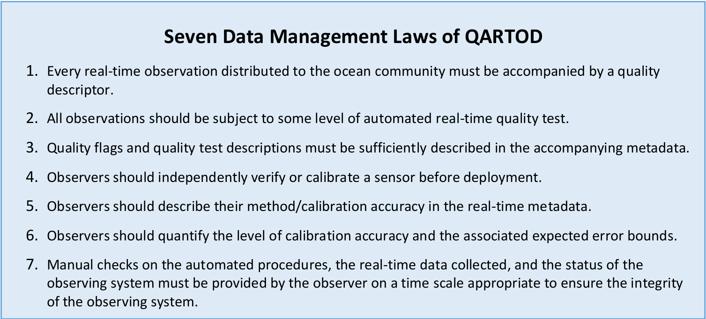
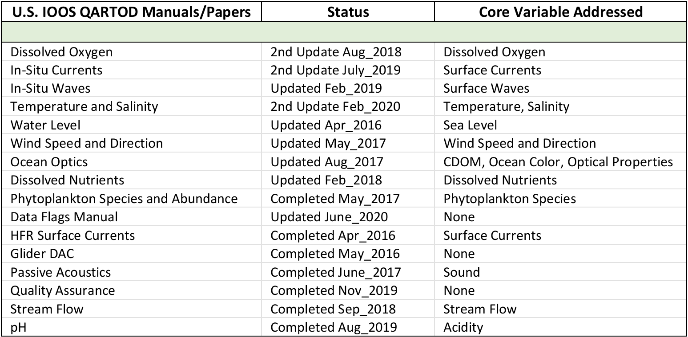
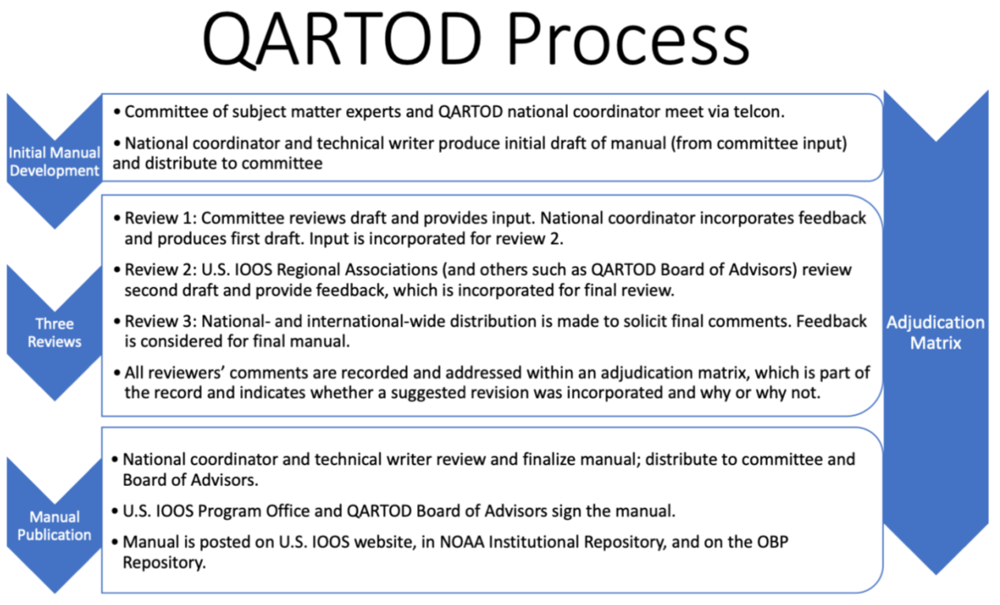
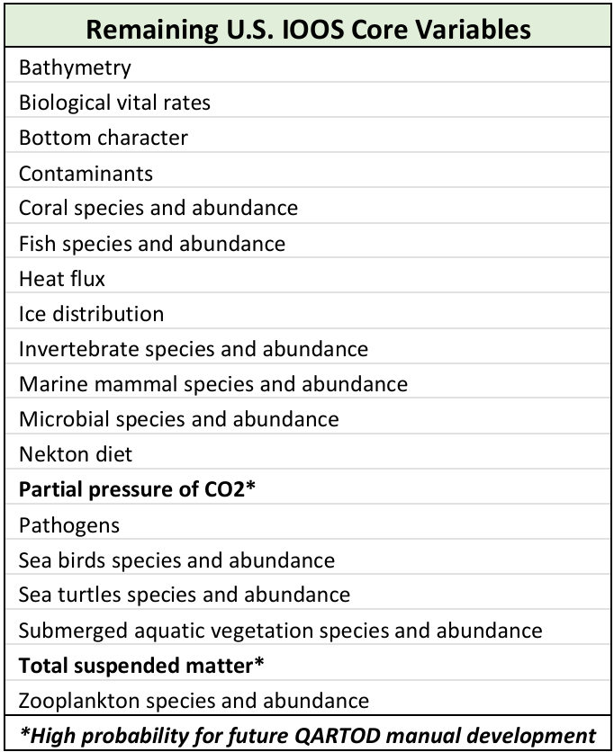
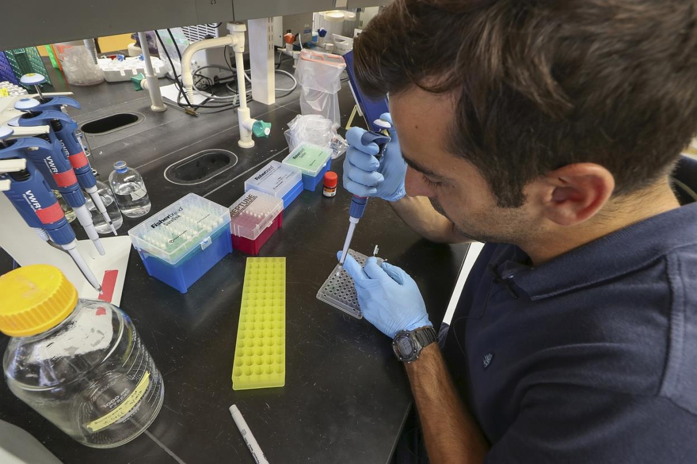

# QARTOD  - Prospects for Real-Time Quality Control Manuals, How to Create Them, and a Vision for Advanced Implementation 

_Mark Bushnell_¹, _Kathleen Bailey_¹, _Julie Bosch_², _Eugene Burger_³, _Jennifer Dorton_⁴, _Regina Easley_⁵, _Bob Heitsenrether_⁶, _Jeff King_**⁷, _Karen Grissom_⁸, _Mario Tamburri_⁹, _Julianna Thomas_¹⁰, _Christoph Waldmann_¹¹

<small>*¹U.S. Integrated Ocean Observing System, ²National Centers for Environmental Information, ³Pacific Marine Environmental Laboratory, ⁴Southeast Coastal Ocean Observing Regional Association, ⁵National Institute of Standards and Technology, ⁶Center for Operational Oceanographic Products and Services, ⁷U.S. Army Corps of Engineers, ⁸National Data Buoy Center, ⁹Alliance for Coastal Technologies, ¹⁰Scripps Institution of Oceanography [retired], ¹¹University of Bremen Center for Marine Environmental Sciences*</small>

## Abstract 

The United States Integrated Ocean Observing System® (U.S. IOOS®) Quality Assurance / Quality Control of Real-Time Oceanographic Data (QARTOD) Project marshaled hundreds of volunteer subject-matter experts to identify tests to evaluate real-time data quality by variable and instrument type. 
These quality control steps, 
outlined in QARTOD manuals, are crucial for documenting the reliability of the collected real-time environmental data. 
QARTOD, which began as an ad hoc effort in 2003, has published thirteen quality control manuals. 
Specific aspirations for future QARTOD efforts include revising existing manuals, 
identifying new manuals for development based on the QARTOD community development process, 
and promoting the documented quality control procedures within the IOOS and broader ocean observing system communities. 

QARTOD manuals characterize the quality control processes as required, 
strongly recommended, 
or suggested for each sensor type. QARTOD manuals can be developed only when, 1) interoperable data streams are employed, 2) data are disseminated and used in real-time, and 3) there is sufficient community expertise and interest. 
An initial review of U.S. IOOS core variables and Global Ocean Observing System Essential Ocean Variables (considering these three requirements) reveals no remaining variables with an immediate need for manual development. 
As technologies advance, the observational maturity increases for these variables, 
as will the need for a QARTOD manual. 

QARTOD QC tests are now being implemented by operators at ocean observing systems around the world. 
Technological progress (e.g., autonomous vehicles) suggests a high potential for expanding the real-time quality control measures integrated within field instrumentation. 
Most required QARTOD tests can be embedded and implemented within the field-deployed equipment, 
and QARTOD-ready devices likely will be available soon. 
As the Internet of Things grows to include oceanographic hardware (Xu et al. 2019), 
such embedded QC processes will become important.

Please cite this document as: 

    U.S. Integrated Ocean Observing System, 2020. QARTOD - Prospects for Real-Time Quality Control Manuals, How to Create Them, and a Vision for Advanced Implementation. 22 pp. DOI: 10.25923/ysj8-5n28

## Background: QARTOD 2012-2019 

A 2003 meeting of 80 people who thought it was important to produce the highest data quality possible ultimately led to the genesis of QARTOD (Quality Assurance / Quality Control of Real-Time Oceanographic Data). 
This grassroots effort is now a well-recognized name throughout the global oceanographic community. 
The idea for integrating ocean-observing organizations and agencies throughout the U.S. and globally emerged over time and is described in publications such as _the First U.S. Ocean Observing System (IOOS) Development Plan_ in 2006 (Ocean.US 2006). 
Numerous federal and non-federal agencies in the U.S. have long collected data remotely and in-situ and understand the importance of high-quality data. 
Oceanographers from many of those agencies participated in at least one QARTOD workshop, 
held biennially from 2003 through 2009. 
By the time U.S. IOOS adopted QARTOD as an official project in 2012, 
federal and non-federal partners had provided a solid foundation for achieving data quality control through documentation of the QARTOD workshops (2003–2009). 

That first grassroots meeting resulted in a framework describing the conditions needed for the quality control of real-time observations. 
Subsequently, 
these have become known as the Seven Data Management Laws of QARTOD (Figure 1). 
These “laws” guide the development of the quality control (QC) test procedures in each manual. 

<figcaption>Figure 1. Seven data management laws of QARTOD (Burnett et al. 2009)</figcaption>

The QARTOD Project initially represented a vision of producing a manual for 26 specific core variables¹ (e.g., water levels, currents, waves, phytoplankton, etc.). 
More recently, 
the 31 Global Ocean Observing System (GOOS) Essential Ocean Variables (EOVs) have also been considered as candidates for a manual². 
The intended audiences of the manuals are those who are creating software to automate real-time QC tests. 
Each manual describes the process of automating the generation of quality control flags—usually pass, 
suspect, 
or fail (U.S. IOOS 2020). 
Data points flagged as suspect require a human in the loop to further inspect the data point and verify the quality of these observations. 
Each manual describes the specific tests needed for that variable, 
along with sample codable instructions that are helpful to those setting up automated data collection programs to flag data exceeding certain pre-selected thresholds. 
These test procedures are outlined in every QARTOD manual.

The QARTOD Project became critical to the task of developing formal U.S. IOOS data standards for data collected by the U.S. IOOS Regional Associations (RAs), 
a consortia of non-federal data providers and users responsible for establishing, 
operating, 
and improving regional ocean observing systems. 
The U.S. is organized into eleven RAs, representing coastal, 
Great Lakes, 
and Caribbean regions with different ocean-observing considerations. 
After several years of project management by U.S. IOOS, 
it was noticed that QARTOD QC tests were increasingly being implemented internationally. 
As a result, 
the original opportunity for “courtesy” reviews by international communities became a formal element, 
and the manuals came to be developed with global assistance.

<small>¹ U.S. IOOS started with 26 core variables and expanded to 34 variables. See https://ioos.noaa.gov/about/ioos-by-the-numbers/.</small>

<small>² Global Ocean Observing System Essential Ocean Variables. See https://www.goosocean.org/index.php?option=com_content&view=article&id=14&Itemid=114</small>

## QARTOD Reaching Maturity: Lessons Learned 

Seventeen years after the first grassroots meeting, 
the QARTOD Project is now at a point of transition. 
The effort has produced thirteen QC manuals (and three papers) addressing many of the U.S. IOOS core variables. 
With each new manual and manual updates (some manuals have been updated twice), 
U.S. IOOS and the ocean-observing community have also acquired a more comprehensive understanding of data quality control through the preparation of these documents. 

The original (2012) project plan targeted work through 2016 (Toll 2012). 
In 2016, 
the original plan was extended out five years (through 2021) (U.S. IOOS 2017). 
The detailed work plan for 2020 included identification of new variables for which a QARTOD manual is needed, 
as well as updates to existing manuals, 
if required. 
Figure 2 shows the status of QARTOD manuals prepared to date.

<figcaption>Figure 2. Status of QARTOD manuals and papers</figcaption>

Note that in Figure 2, 
three manuals are outside the list of core variables and were prepared at the request of a specific community. 
The data flags manual explains the selection rationale of the five different QARTOD flags, 
the HFR surface currents manual provides expanded guidance for surface current measurements, 
and the Glider Data Assembly Center manual is specific to collecting data on the glider platform. 
A quality assurance appendix to each manual was published as a quality assurance paper (Bushnell et al. 2019) and covers general quality assurance issues. 
The paper also provides examples of detailed checklists and a comprehensive example of a data uncertainty calculation. 

One of the pillars of QARTOD is the process itself—how it encompasses an ever-widening circle of subject-matter experts through the three iterations of manual review (Figure 3; Bushnell 2015). 
The QARTOD process has included more than 200 subject-matter experts to develop the QC manuals and related documents. 
For each review, 
proposed revisions and comments are logged into an adjudication matrix, 
and each revision and comment receive an explanation for whether the suggestion is incorporated (and if not, why). 
Adjustments to the QARTOD manual development process are made as needed to ensure efficiency and thoroughness, 
such as the previously mentioned formal inclusion of an international review. 

<figcaption>Figure 3. QARTOD process</figcaption>

### Table of Selected Definitions 

The key factor in the decision to include a table of selected definitions in each manual is the realization that ocean observers might differ in their definitions of certain terms; 
therefore, 
it is helpful to state how specific terms are defined and used in the manual. 
This effort began with defining the most basic terms used throughout each manual: 
real-time, 
quality control, 
and quality assurance. 

### Real-Time 

The focus of QARTOD manuals is on real-time QC. 
However, 
a continuum of QC efforts exists, 
which improves data quality with the passage of time and acquisition of more data. 
Some examples of temporal data provision are: 

- Real-time is when data are delivered without delay for immediate use; time series extends only backwards in time; and sample intervals may range from a few seconds to a few hours or even days, depending upon the sensor configuration. Latency is typically minutes to hours. 

- Near-real-time is not necessarily focused on the most current data point and has some tolerance for delayed dissemination. Latency may be hours to days. 

- Delayed mode is not focused on the most current data point; there is acceptance of delay. Latency is typically days to months. 

- Post-processed means acceptance of considerable delay but may include corrections provided by evaluation of the entire instrument deployment and post-calibrations. Post-processing may occur after months or years. 

- Re-analysis includes related variables and data sets, as well as reviews of overall sensor/systems performance. Such efforts are usually conducted years or decades after initial data acquisition. 

These are not strict partitions; 
many programs may provide real-time data and consider delayed and post-processed as identical. 
Data that might not be considered real-time may still benefit from QARTOD QC. 
The tests may serve as a starting point for the QC of non-real-time data, 
such as delayed mode. 

### Quality Control and Quality Assurance 

Terms such as quality control and quality assurance are defined in early manuals with examples of each given in the narrative. 
The two terms are sometimes used interchangeably, 
and it was not always clear that reviewers actually agreed on the distinction between the two. 
QC is product oriented – or in the case of the manuals, all of the QC tests for the variable. 
QC is testing the data point against thresholds after it is received. 
QA is process oriented – assuring quality in the process of calibrating an instrument, 
setting it up, 
and integrating into the system. 

The content describing QA, 
appended to each QARTOD manual, 
was too general for many reviewers. 
Recent efforts expand upon QA within the QARTOD Project, 
resulting in the Bushnell et al. (2019) paper, 
inclusion of QA in the 2020 QARTOD project plans, and support of the newly emergent and wellrespected Ocean Best Practices System ([OBPS], https://www.oceanbestpractices.org/). 
Beginning with the update to the temperature and salinity manual in 2020, 
the QA appendix was removed, 
and manual users are referred to Bushnell et al. (2019).

**Other Terms**

During the QARTOD manual development process, 
other terms emerged that needed to be defined, 
including interoperable, 
sensor, 
variable, 
and operator. 

_Interoperable_ refers to the ability of two or more systems to exchange and use data, 
metadata, 
information, 
or system parameters following established protocols or standards. 
This term is important because interoperability is required before automated QC testing can be implemented. 

_Sensor_ is strictly defined as an “element of a measuring system that is directly affected by a phenomenon, 
body, 
or substance carrying a quantity to be measured” (JCGM 2012). 
However, 
it is also commonly used to identify a much broader composition of measurement system elements such as digitizers, 
firmware applying calibration to create data with engineering units, 
and data recording and telemetry functions – a measuring instrument. 

_Variable_ is an observation (or measurement) of physical and biogeochemical properties within oceanographic and/or meteorological environments. 
We refer to the listings provided by the Interagency Ocean Observation Committee (IOOC) 34 Core Ocean Variables (COVs) and the GOOS 31 EOVs². 
These are important here, 
because not all COVs and EOVs have sensors capable of generating interoperable data in real-time. 

_Operator_, 
in QARTOD manuals, 
refers to those entities engaged in the collection, 
generation, 
and dissemination of oceanographic data (i.e., data provider). 
While the term is generally used in juxtaposition to _user_, 
operators can also be users of their own data. 

### Certification 

Implementation of QARTOD real-time QC can play a key role in obtaining more formal acceptance for data providers (operators). 
In some instances, QARTOD implementation may be required. 
In others, 
requirements may vary broadly depending upon the authority issuing acceptance of the provider capabilities. 

For example, 
the ICOOS Act of 2009 directed the National Oceanic and Atmospheric Administration (NOAA) to certify and integrate Regional Information Coordination Entities (RICEs) into the U.S. IOOS. 
RICE certification formally establishes the role of the entity within U.S. IOOS and ensures that the data disseminated by the RICE are managed using the best practices identified by NOAA. 

To obtain RICE certification, 
data providers must show they meet the requirements established in the U.S. Integrated Ocean Observing System: Regulations to Certify and Integrate Regional Information Coordination Entities³. 
RICE certification requirements include meeting quality control standards for variables that have an associated QARTOD manual. 
As of 2019, 
all eleven U.S. IOOS RAs had achieved RICE certification⁴. 

<small>² http://www.goosocean.org/index.php?option=com_content&view=article&id=14&Itemid=114</small>

<small>³ https://cdn.ioos.noaa.gov/media/2017/12/ioos_certification_final_rule.pdf</small>

<small>⁴ Additional RICE certification information can be found at https://ioos.noaa.gov/about/governance-and-management/certification-extending-reach-regional-data/.</small> 

### U.S. IOOS Core Ocean Variables Versus Essential Ocean Variables 

U.S. IOOS began with 26 variables that originated early in the process – well before U.S. IOOS assumed responsibility for QARTOD in 2012. 
Nine QARTOD manuals were already published when U.S. IOOS increased the number of core variables to 34 in 2018⁵ and grouped variables into one of three categories: 
physical, 
biogeochemical, 
and biological (ecosystems). 
This addition represents the importance of ecosystem monitoring and adds several variables important for determining the health of ecosystems. 
Internationally, 
GOOS identified EOVs⁶ that include even more specific attributes to help understand global ecosystems. 
QARTOD attempted to match U.S. IOOS core variables to EOVs but found there was no way to compare them. 
The need for core variables for each U.S. IOOS Regional Association is not identical to EOVs; therefore, 
EOVs have not replaced the 34 core variables. 
While a harmonization of COVs and EOVs is desirable, 
it is not required for the development of further QC manuals. 
The process to create a QARTOD manual would be the same for any variable from any listing. 

### Accessibility of QARTOD Manuals 

Documents can become difficult to access if the IP address changes or a website is updated. 
Therefore, 
all QARTOD manuals have received a Digital Object Identifier (DOI) and have been placed in the NOAA Institutional Repository⁷ and the Ocean Best Practices Repository⁸. 
QARTOD documents also reside on the U.S. IOOS website⁹. 

### Data Measurement Uncertainty 

QARTOD draws distinctions between data quality assurance and quality control but also stresses their close relationship. 
As QARTOD manuals have evolved, 
so have the needs to define more clearly what high-quality data are and how to achieve the best quality possible. 
Bushnell et al. (2019) include a discussion of data measurement uncertainty, 
defined as a "non-negative parameter characterizing the dispersion of the quantity values being attributed to a measurand, 
based on the information used". 
The paper also includes an example of a rigorous measurement uncertainty calculation. 

Although data measurement uncertainty is not a part of the real-time QC process outlined in QARTOD manuals, 
it illustrates how QARTOD has expanded the conversation about different facets of highquality data going forward. 
Measurement uncertainty directly addresses the sixth Data Management Law of QARTOD, 
_Observers should quantify the level of calibration accuracy and the associated expected error bounds (Figure 1)_. 
However, 
calibration accuracy is only one of many elements contributing to measurement uncertainty quantification. 
Others include electronic stability, 
sensor drift, 
biofouling, 
and even the spatial and temporal variability of the measurand itself. 
Rigorous uncertainty calculations can quickly become quite complex. 

<small>⁵ https://ioos.noaa.gov/about/ioos-by-the-numbers/</small> 

<small>⁶ https://www.goosocean.org/index.php?option=com_content&view=article&id=14&Itemid=114</small>

<small>⁷ https://repository.library.noaa.gov/</small>

<small>⁸ https://www.oceanbestpractices.org/</small> 

<small>⁹ https://ioos.noaa.gov/</small>

### QARTOD Outreach 

QARTOD accomplishments reach well beyond developing real-time quality control manuals. 
The QARTOD National Coordinator and Board of Advisors pursued a broad outreach strategy to explain the goals of real-time QC by participating in conferences and workshops, 
as well as authoring papers and articles for conferences, 
trade publications, 
and journals. 
For example, 
QARTOD papers were presented at the IEEE/Marine Technology Society Oceans ’15 through Oceans ’18 international meetings, 
as well as other conferences such as the American Geological Union, 
Ocean Sciences, 
the Data Buoy Cooperation Panel, 
Oceanology, 
Ocean Networks Canada, 
Radio Operators Working Group, 
and several others. 
National Coordinator Mark Bushnell was the guest editor for the February 2016 issue of _Sea Technology Magazine,_ and QARTOD news articles appeared in publications such as _Marine Technology Reporter_, 
_ECO World News Magazine_, 
_Ocean News and Technology_, 
and the IEEE Oceanic Engineering Society _Beacon_. 
A QARTOD one-page document was developed to provide a concise description of the QARTOD Project (appendix A).

|**Year**|**Conference Name**|
|---|---|
|**2009**|• OceanObs’09, Venice, Italy|
|**2010**|• International Marine Data and Information Systems Conference, Paris, France|
|**2012**|• Oceans’12, Virginia Beach, Virginia|
|**2014**|• Ocean Optics Protocols Workshop, Portland, Maine • Oceans’14, St. John’s, Newfoundland|
|**2015**|• American Shore & Beach Preservation Association, New Orleans, Louisiana • Coastal & Estuarine Research Federation, Portland, Oregon (presentation by Emilio Mayorga) • Currents, Waves, & Turbulence Measurements Workshop, St Petersburg, Florida • IEEE/MTS OCEANS’15, National Harbor, Maryland • Joint Radiowave Oceanography Workshop / Radiowave Operators Working Group Meeting, Woods Hole, Massachusetts • Data Management and Communications annual meeting, Silver Spring, Maryland|
|**2016**|• OceanObs Research Coordination Network Meeting, San Francisco, California • MTS/IEEE OCEANS’16, Monterey, California • Ocean Networks Canada QARTOD Workshop, Victoria, British Columbia • Pacific Marine Environmental Laboratory, (remote participation) • Second JCOMM Marine Instrument Workshop for WMO Regional Association IV with focus on wave measurements from moored buoys, Gulfport, Mississippi|
|**2017**|• CERF, Providence, Rhode Island • AtlantOS Transatlantic Ocean Data Harmonization Workshop, Brussels, Belgium • Data Buoy Cooperation Panel 32, La Jolla, California • American Geophysical Union, New Orleans, Louisiana • IEEE/MTS OCEANS’17, Anchorage, Alaska|
|**2018**|• IEEE/MTS OCEANS’18, Charleston, South Carolina • Data Management and Communications annual meeting, Silver Spring, Maryland • National Hydrologic Warning Council, Transmission newsletter, July 2018 issue • DBCP, Cape Town, South Africa • Special issue of the Marine Technology Society Journal - An Intergovernmental Blueprint for Community Resiliency: The Hampton Roads Sea Level Rise Preparedness and Resilience Intergovernmental Pilot Project, March/April 2018 issue • National Water Quality Monitoring Council Web Meeting (remote participation) • Ocean Sciences session for Real-Time Quality Control of Ocean Data, Portland, Oregon|
|**2019**|• Association for the Sciences of Limnology and Oceanography, San Juan, Puerto Rico • Ocean Observatories Initiative Facility Board & Data Delivery and Cyber Infrastructure Committee, Alexandria, VA (remote participation) • UG2 – EGO Glider Workshop, Rutgers University, New Jersey • DMAC, Silver Spring, Maryland • OceanObs’19, Honolulu, Hawaii|
|**2020**|• Ocean Sciences Meeting, San Diego, California|

: Table 1. Conferences with QARTOD participation.

Relevant conferences have served as the kick-off for some QARTOD manuals. 
For example, 
a workshop on real-time QC of pH observations was hosted by U.S. IOOS at the Association for the Sciences of Limnology and Oceanography meeting in Puerto Rico in February 2019. 
This resulted in the development of the pH manual. 
The ocean optics QC manual was launched during the October 2014 Ocean Optics Protocols Workshop in Portland, Maine. 

Quality control tests from QARTOD manuals and QA/QC of critical datasets have been incorporated into the curricula of an operational oceanography master’s program at Rutgers University. 
The results of the curriculum development and implantation are found in _Workforce Development Supporting the Blue Economy: Using Recent Community-Developed Material in Operational Oceanography Curricula_ (Bushnell et al. 2018). 
The paper was dedicated to the memory of Vembu Subramanian, 
who had suggested that academic institutions might use QARTOD manuals in their classrooms. 

### QARTOD Implementation 

One early implementor of QARTOD was the Coastal Data Information Program (CDIP) at Scripps Institution of Oceanography. 
CDIP (formed in 1975) has long been a leader of the real-time QC of wave data. 
CDIP personnel were instrumental in the initial grassroots QARTOD effort, 
and many wave QC tests adopted by QARTOD began with CDIP. 

The U.S. IOOS Program Office uses QARTOD standards as guidance for the eleven RAs; 
therefore, the RAs were among the earliest adopters of these standards. 
Efforts by these communities led the climate and forecast (CF) metadata convention governance committee to add QARTOD-inspired standard names¹⁰. 
The full set of CF standard names available to identify QARTOD flag ancillary variables can be found in the CF Standard Name Table v72¹¹. 
The search tool can be employed to find quality-related flag variable names. 
Implementation of these standardized flag names are further described, 
and an example is provided, 
in the U.S. IOOS Metadata Profile Version 1.2¹². 
Further documentation of U.S. IOOS QARTOD and other QC tests, 
implemented in Python with notebook examples, 
have been developed and shared by the community¹³. 

QARTOD has also received feedback from data providers in the private and public sectors about their own QARTOD implementation efforts. 
SiMCosta (the Brazilian Coastal Monitoring System), 
the U.S. Army Corps of Engineers, 
Fugro, 
Teledyne RDI, 
and several others are working with the National Coordinator to inform and provide assistance in their QARTOD implementation efforts. 
Table 2 provides an overview of the kinds of implementation efforts about which QARTOD has received feedback. 

<small>¹⁰ https://github.com/cf-convention/cf-conventions/issues/216</small>

<small>¹¹ http://cfconventions.org/Data/cf-standard-names/72/build/cf-standard-name-table.html</small>

<small>¹² https://ioos.github.io/ioos-metadata/ioos-metadata-profile-v1-2.html-quality-controlqartod</small>

<small>¹³ https://github.com/ioos/ioos_qc and https://ioos.github.io/ioos_qc/</small>

|**Entity**|**Description of Effort**|
|---|---|
|**U.S.**||
|CDIP|The Coastal Data Information Program at Scripps Institution of Oceanography personnel were leaders in the initial grass-roots QARTOD effort. They implemented all 21 waves QC tests and continue to provide strong support for this US IOOS project. (Julianna Thomas)|
|IOOS RAs|All eleven Regional Associations have implemented the required QARTOD data QC tests and have received certification. There are many individual examples of implementation of required data QC tests, as well as several highly recommended and suggested tests for those variables measured by each RA.|
|Ocean Observatories Initiative|“The overall goal is to ensure that the data and metadata delivered by the OOI meet community data quality standards. These standards were designed with the goal of meeting the Integrated Ocean Observing System (IOOS) Quality Assurance of Real Time Ocean Data (QARTOD) standards.” (Smith et al. 2018).|
|WaveForce Technologies|“We’ve applied QARTOD rules when rebuilding the USACE/FRF database.” (Jeff Hansen)|
|Teledyne RDI|“We’re working to implement some of the tests within the instrument.” (Daryl Symonds)|
|PMEL|“As a result of your presentation, the PMEL Carbon group are now incorporating some of the QARTOD QC procedures into their data processing.” (Eugene Burger)|
|Rutgers University|“Working with Rutgers team to implement glider QC there. Created a CDL file to create a netCDF file that contains all flag variables for groups 1 & 2 in the QARTOD manual. “(John Kerfoot)|
|Sea-Bird Scientific|Working to embed QARTOD tests in their SeaFET V2 pH sensor (Charles Branham)|
|**International**||
|OMC - Melbourne, Australia|Implemented some QARTOD tests for our Datawell wave processing as well as tide monitoring systems. Interested in hearing about further developments to the QARTOD manuals. (Carsten Hofmann, Senior Coastal Engineer)|
|British Oceanographic Data Centre|Editing update to GLOSS QC Manual. Want to expand the RT quality control section and requests permission to add several QARTOD tests to the list of tests required for GLOSS RT sea level data. (Elizabeth Bradshaw)|
|Bundesamt fuer Seeschiffahrt und Hydrographie|Have started to implement QARTOD wave QC testing. The QARTOD waves QC manual lacks identification of extreme waves. (Christian Senet)|
|FUGRO UK|Requested the updated WL manual, said “We've been advocating QARTOD in the oil and gas sector for quite a few years…” (Mark Calverley)|
|SIMCosta|“Implementing QARTOD in SiMCosta, the Brazilian Coastal Monitoring System. Want to interact with the QARTOD team.” (Carlos Garcia)|
|European Marine Energy Centre (EMEC) Ltd.|“We are currently developing own in-house metocean data processing suite and are planning to align our data processing procedure with QARTOD guidelines. As a priority, ADCP and surface wave processing tools are currently being developed. “Although we are primarily processing data collected in self-contained (non-real-time) mode, the QARTOD manual recommendations appeared to be easily adaptable for such usage and very helpful. “The QARTOD project is very useful and we will most certainly continue following your work.” (David Darbinyan,Senior Metocean Engineer)|

: Table 2. Summary of Implementation Efforts.

## QARTOD 2020 and Beyond 

### Data Provider Needs and Requirements for Real-time QC 

QARTOD manuals are designed to provide general guidance to those collecting and disseminating core ocean variable data in real-time. 
However, 
future requirements for specific variables could change. 
Perhaps the technology is still being developed, 
or the time scale for certain variables could move from daily or weekly to real-time. 
Examples of these scenarios are described below (_Communities Encouraged to Develop QARTOD Manuals_). 

QARTOD has focused 2020 efforts on incremental updates for two manuals (temperature/salinity and data flags). 
Quarterly teleconferences keep the Board of Advisors updated, 
and attendance at various conferences and workshops help the National Coordinator to remain engaged with the needs and requirements of national and international ocean-observing communities. 
The National Coordinator also serves as a moderator for the Ecosystems Mooring Forum and has continual involvement with the OBPS.

### International Interest in Best Practices 

U.S. IOOS has been supportive of the OBPS effort since inception in 2017 through attendance at workshops and participation in the founding working group (now the IOC OBPS Steering Group). 
This support is expected to continue at a similar level of effort. 
As a result of that involvement, 
QARTOD manuals and many other NOAA documents have been posted to the OBPS Repository. 

Close collaboration between the QARTOD Project and the OBPS is mutually beneficial. 
QARTOD gains because the QC manuals become further findable, 
accessible, 
interoperable, 
and re-useable, 
and OBPS is rewarded by inclusion of accepted QC best practices into the repository. 

### Communities Encouraged to Develop QARTOD Manuals 

The future QARTOD focus is on updating existing manuals and not developing new ones. 
However, 
ocean-observing communities are in an excellent position to determine when the time is ripe for new manual development. 
The National Coordinator, 
QARTOD Board of Advisors, 
and U.S. IOOS Program Office are uniquely positioned to assist communities that eventually might have a need for standardized real-time QC. 

Figure 4 lists the COVs that are not presently addressed by a QARTOD manual. 
Evaluation of the remaining variables must consider the requirements for a traditional QARTOD manual, 
which include: 

- Interoperable data stream

- Use of data in real-time and need for real-time QC

- Community expertise and interest

<figcaption>Figure 4. Remaining U.S. IOOS core variables.</figcaption>

Of the remaining 19 variables, 
the following could be ready for real-time QC within the next few years: 

- **Partial pressure of CO2** – A useful example of QA/QC treatment for carbonate system sensors is the FixO3 (The Fixed point Open Ocean Observatories) Handbook of Best Practices (Sastri et al., 2019), available at several websites including the International Ocean Carbon Coordination Project¹⁴. The FixO3 Handbook details best practices for deployment, calibration, and quality control recommendations developed by the International OceanSITES initiative. Ultimately, however, the FixO3 Handbook acknowledges that quality control procedures for carbonate system sensors are not ready to be adopted as “best practices” and further work is required. The Essential Ocean Variable (EOV): Carbonate System description by the GOOS also reflects this conclusion with its assessment of the readiness level of some OA [ocean acidification] sensor types. 

- **Total suspended matter** – Also known as total suspended solids, this is a common measure of water quality and closely related to turbidity. Water is filtered and filters are dried and weighed to obtain the weight per unit volume. Since the process is conducted manually, each result is reviewed by the analyst. However, the results may not be examined in the larger context of previous or nearby observations, so traditional QARTOD QC tests could be of value. 

The following variables either do not require real-time QC or real-time QC is not presently feasible. 
This is not to diminish the importance of these variables. 
Existing QARTOD manuals describe the process of automating the generation of quality control flags—usually pass, 
suspect, 
or fail. 
It is emphasized that a suspect flag requires a human in the loop to further inspect the data point and verify the quality of the observation. 
For those variables observed with a human continually in the loop with limited or no automation in the process, 
all data are already reviewed manually. 
There is no need to highlight suspect data points.

<small>¹⁴ http://www.ioccp.org/images/03TimeSeries/FixO3_Handbook-of-best-practices_2016.pdf</small>

The following variables do not require real-time QC: 

- **Ice distribution** – Discussions with personnel from the National Ice Center and the National Snow and Ice Data Center did not reveal interoperable data streams. Products are generated on weekly time scales, and manual evaluation is sufficient. However, there is some discussion regarding real-time QC¹⁵. 

The University of Alaska Fairbanks (UAF) School of Fisheries and Ocean Sciences partnered with Pacific Gyre to receive a 3-year Ocean Technology Transition award in 2014¹⁶. 
Their work resulted in instrumentation on a buoy that provided real-time data on the vertical temperature and salinity structure to determine freeze-up conditions. 
The mooring provided data in real-time to scientists at UAF, 
forecasters at the National Weather Service, and others¹⁷. 
While this was useful as a demonstration, they encountered mooring difficulties; 
no real-time capability exists at present. 

- **Heat flux** – Heat flux is derived from multiple met/ocean variables, which are presently addressed by QARTOD manuals such as temperature, winds, and optical properties (Yu and Weller 2007). 

For the following variables, real-time QC is not feasible at present: 

- **Contaminants** – This core variable lacks definition and is too vague for a specific real-time QC manual. The U.S. Environmental Protection Agency (EPA) uses the Safe Drinking Water Act definition of _contaminant_ as “any physical, chemical, biological or radiological substance or matter in water”. QARTOD manuals discuss sensor technology to help users understand the challenges involved in data collection, and to explain how the QC tests can be used to identify good, suspect, and bad data. This cannot be done without knowing the nature of the contaminant and the instruments used to measure it. For example, do the contaminants float, sink, or are they dispersed throughout the water column? 

- **Microplastics** - One interesting example of a contaminant is microplastics. There is a lack of standard collection methods, which prevents measurement comparisons or identification of trends in microplastics contamination¹⁸. Reference standards are poor (spheres, not representative) or non-existent. Samples collected by nets can allow long, thin fibers to go through nets and be under-sampled. Whole water samples show that microplastics are far more abundant.

- **Pathogens** – The real-time quality control of observations of pathogens (viruses, bacteria, fungi, protozoa, and worms) is certainly desired in real-time. In fact, it is required: “… _the BEACH Act requires all coastal and Great Lakes states to adopt EPA Ambient Water Quality Criteria for the pathogen indicator organisms E. coli or enterococci for beach and recreational water quality monitoring.” And, “Beach and recreational water quality monitoring may include a number of measurements in addition to those for bacteria indicator organisms—for example, parameters such as rainfall, water and air temperature, water turbidity, and wind speed and direction._ ” _(U.S. ERG, Inc. 2002)_. As yet there are no commonly known pathogen sensors. Water samples are manually collected and transported to a lab for manual analysis. There are no automated processes and no interoperable data stream to which automated QC could be applied. 

- **Bottom character** – This variable does not have an interoperable data stream. 

- **Biological vital rates** – This variable is vague and does not have an interoperable data stream. 

- **Coral species and abundance** - These observations are manually conducted and are not disseminated in real-time. 

- **Fish species/abundance** – Conversations with biologists indicate emerging active acoustics and video imaging technologies that show promise, but these techniques are still research activities (pers. Comm., C. Reiss). If these technologies advance to real-time status, massive data sets are anticipated (Kearns, 2019, https://www.youtube.com/watch?v=jGzZs0cjdmE). 

- **Invertebrate species and abundance** - These observations are manually conducted and are not disseminated in real-time. 

- **Marine mammal species/abundance** - These observations are manually conducted and are not disseminated in real-time. They can be inferred from ocean acoustics, which is partially addressed in the passive acoustics QARTOD manual. 

- **Microbial species/abundance/activity** - Observations of microbial species, abundance, and activity are often conducted as part of a research project. They usually require measurements of other variables for which QARTOD manuals do exist, such as temperature and salinity, currents, pH, etc. However, the species, their abundance, and their activity are determined, described, and distributed through human effort (Figure 5). A manual providing guidance for the development and implementation of software for automated QC is not needed if there is no automation elsewhere in the data management process. 

<small>¹⁵ http://nsidc.org/arcticseaicenews/faq/-quality_control and https://www.navcen.uscg.gov/?pageName=NAIceService</small>

<small>¹⁶ https://ioos.noaa.gov/project/ott-real-time-sensor-system-detecting-freeze-arctic-shelves/</small> 

<small>¹⁷ https://aoos.org/ice-detection-buoy</small>

<small>¹⁸ https://www.aimspress.com/fileOther/PDF/environmental/Environ-06-05-326.pdf</small>

<figcaption>Figure 5. Miguel Semedo at the Virginia Institute of Marine Science conducts manual water quality evaluations. Photo courtesy of Lisa Sadler.</figcaption>

- **Nekton diet** - These observations are conducted manually and are not disseminated in realtime. 

- **Sea birds species/abundance** - These observations are conducted manually and are not disseminated in real-time. 

- **Sea turtles species/abundance** - These observations are conducted manually and are not disseminated in real-time. 

- **Submerged aquatic vegetation species/abundance** - These observations are conducted manually and are not disseminated in real-time. 

- **Zooplankton species/abundance** - Data are not disseminated in real-time, and there are no interoperable data streams. Automated imaging sensors such as McLane’s Imaging FlowCytobots (IFCB) observations were included in the QARTOD phytoplankton manual as an emerging technology. But that manual stood upon older fluorescent-based measurements. In the case of IFCB zooplankton observations, they are still considered a research activity¹⁹. 

Another emerging technology (spanning many of these biological core variables) that will need realtime QC is the measurement of environmental DNA (Hansen et al. 2020). 
However, 
these observations are also considered a research activity, 
and QC is carried out manually at present. 

<small>¹⁹ (Also see _An assessment of the use of ocean gliders to undertake acoustic measurements of zooplankton: the distribution and density of Antarctic krill (Euphausia superba) in the Weddell Sea_ https://www.oceanbestpractices.net/handle/11329/895.)</small>

## Advanced Implementation 

Many field systems employ QC processes embedded within the instrument firmware, 
and many QARTOD QC tests involve the results of these tests. 
This is especially true of the waves, 
currents, 
and HF radar manuals. 
Manufacturers should consider expansion of their embedded real-time QC processes, 
including data flagging within their sensors and field components as described in Bushnell (2017). 
These QARTOD-enabled devices would provide emerging operators an equal footing with larger data integrators. 
Cars have been alerting operators of system component failures for decades; 
our oceanographic systems should be able to do the same. 

An informal survey of manufacturers provided interesting insights. 
Some saw the advantages of immediate QC for use by a diverse community, 
while others favored software/firmware management ashore; 
good arguments can be made for each viewpoint. 
All agreed there would be no progress toward onboard QC without market demand. 

As the Internet of Things (IOT) emerges, 
fully networked systems that are remotely and autonomously configurable are likely to become available. 
Increases in sensor-to-sensor communications will make neighbor and multivariate QC analysis more viable. 
QARTOD can work with manufacturers and observing systems operators to facilitate this growth. 
The establishment of accepted standards is the keystone for this development. 

In concert with the emergence of the IOT, 
the Research Data Alliance efforts to develop the persistent identification of instruments²⁰ can be expected to further support interoperability of sensors and systems. 
The creation of a universal way to identify instrument instances offers a wealth of benefits to individuals, 
communities and initiatives. 

<small>²⁰ https://www.rd-alliance.org/group/persistent-identification-instruments/case-statement/persistent-identificationinstruments</small>

## Interaction with New Programs 

U.S. CLIVAR Ocean Uncertainty Quantification Working Group²¹ (OceanUQ) is a three-year project initiated in 2020. 
The objectives are to: a) develop a community-driven web platform for uncertainty quantification knowledge and strategies, 
b) produce peer-reviewed, open-access articles on uncertainty quantification for observational and model ocean data, 
and c) organize a summer school and/or workshop on uncertainty quantification. 
Since documentation of measurement uncertainty is a goal of the QARTOD Project (QARTOD Law 6), 
synergistic cooperation with OceanUQ is effort well spent. 

QARTOD will support the United Nations Decade for Ocean Science for Sustainable Development (20212030)²² by getting involved in programs/initiatives that address long-term monitoring of ocean waters both in coastal regimes and open oceans. 
The data quality standards that had been defined by QARTOD will be instrumental in ensuring the availability of trustworthy ocean data for future generations.

The restructuring process of World Meteorological Organization that started in 2019 will lead to a radically new organizational structure by 2020. 
The main purpose of this transition process is to foster a service-oriented approach toward disseminating quality-checked data and information in due time to their customers. 
In line with that concept, 
a strong focus will be to harmonize QA/QC procedures used in meteorology and ocean observations. 
QARTOD will be able to provide a significant contribution to that process.

<small>²¹ https://usclivar.org/working-groups/ocean-uncertainty-quantification-working-group</small>

<small>²² https://en.unesco.org/ocean-decade</small>

## Summary 

QARTOD began as a grassroots effort in 2003 and became part of U.S. IOOS in 2012. 
QARTOD data quality control procedures are now recognized as an essential part of ensuring data quality control. 
From 2012 through 2019, 
the QARTOD Project produced thirteen manuals describing U.S. IOOS core variables, as well as additional supporting documents and papers. 
QARTOD also conducted extensive outreach to the oceanographic community and beyond. 
The QARTOD Board of Advisors and the National Coordinator authored papers and gave presentations at numerous conferences throughout the world. 
The QARTOD standard for data quality control is now a part of the standards for RICE certification of U.S. IOOS RAs. 

Many core variables requiring real-time QC now have a QARTOD manual. 
As technology advances, 
so will the capability and requirement for real-time QC. 
Additional manuals for variables such as partial pressure of CO2 and total suspended matter could be on the horizon. 
As new variables are identified as being ready for real-time QC, 
communities representing those variables are urged to use the QARTOD process to develop additional manuals. 
U.S. IOOS can help these communities with their efforts. 

## Acknowledgements 

QARTOD manuals are a product created by communities with an interest in the QC of a particular variable, 
and we are indebted to the hundreds of individuals who have volunteered their time to contribute to the development of them, 
review them, 
or use them and provide feedback. 

First, we are grateful to Zdenka Willis (former U.S. IOOS Director) for accepting QARTOD as an IOOS project in 2012. Without her support, 
QARTOD would not have become a reality. 
We also acknowledge the efforts of Capt. Ray Toll (U.S. Navy, ret.), 
who developed the first QARTOD Project Plan and served as the initial QARTOD Project Technical Coordinator. 

We thank Jillian Terhune (Water Quality Manager for the City of Norfolk) and Marcia Snyder (Environmental Health Supervisor for the Virginia Department of Health) for their discussions about the methods used to measure and report pathogen levels in real time. 

We appreciate a discussion with Siri Jodha Khalsa (Colorado State University), 
a member of the National Snow and Ice Data Center who confirmed our understanding of ice observations and data products. 

We acknowledge Jim Potemra (Pacific Islands Ocean Observing System), 
Robert Huber (University of Bremen, MARUM - Center for Marine Environmental Sciences), 
Pauline Simpson (UNESCO / IOC Project Office for IODE), 
and Clay Porch (NOAA Southeast Fisheries Science Center) for their time and effort to review and offer valuable comments on the draft paper. 

## References 

> Burnett, W.; Crout, R.; Bushnell, M.; Thomas, J.; Fredricks, J.; Bosch, J. and Waldmann, C. 2010. Quality Assurance of Real-Time Ocean Data: Evolving Infrastructure and Increasing Data Management to Monitor the World's Environment. In: Proceedings of OceanObs’09: Sustained Ocean Observations and Information for Society, Venice, Italy, 21-25 September 2009, (Vol. 2). (Hall, J., Harrison, D.E. & Stammer, D. (eds)). European Space Agency, 5pp. (ESA Publication WPP-306). DOI:10.5270/OceanObs09.cwp.12 

> Bushnell, M., 2015. "Quality Assurance/Quality Control of Real-Time Oceanographic Data," OCEANS 2015 - MTS/IEEE Washington, Washington, DC, pp. 1-4. DOI: 10.23919/OCEANS.2015.7404613. 

> Bushnell, M. H., 2017. Integration of QARTOD Tests Within a Sensor: Considerations for Sensor Manufacturers. MTS/IEEE OCEANS ’17 conference proceedings, 5 pp. 

> Bushnell, M., Glenn, S., Kohut, J., McDonnell, J., Miles, T., Saba, G. & Schofield, O., 2018, Workforce development supporting the blue economy: Using recent community-developed material in operational oceanography curricula: A tribute to Vembu Subramanian. Marine Technology Society Journal, 52(3), pp. 51-54(4) 

> Bushnell, M., Waldmann, C., Seitz, S., Buckley, E., Tamburri, M., Hermes, J., Heslop, E., and Lara-Lopez, A, 2019. Quality Assurance of Oceanographic Observations: Standards and Guidance Adopted by an International Partnership. Frontiers in Marine Science,  6:706, 12pp. DOI: https://doi.org/10.3389/fmars.2019.00706 

> ERG, Inc. 2002. Time-Relevant Beach and Recreational Water Quality and Monitoring and Reporting. Cincinnati, OH, United Sates Environmental Protection Agency, 59pp. (EPA/625/R-02/017)(NTIS PB2003104886) 

> Hansen, B.K., Jacobsen, M.W., Middelboe, A.L. et al. Remote, autonomous real-time monitoring of environmental DNA from commercial fish. Sci Rep 10, 13272 (2020). https://doi.org/10.1038/s41598020-70206-8 

> Joint Committee for Guides in Metrology (JCGM) 2012. International Vocabulary of Metrology: Basic and General Concepts and Associated Terms. (3rd Edition). 108pp. Available: <u>https://www.bipm.org/utils/common/documents/jcgm/JCGM_200_2012.pdf. Accessed 21 August 2020.</u> 

> Ocean.US, 2006. National Office for Integrated and Sustained Ocean Observations. The First U.S. Integrated Ocean Observing System (IOOS) Development Plan, Publication 9, January 2006. 

> Sastri, A., et al., 2019. Perspectives on In Situ Sensors for Ocean Acidification Research, Frontiers in Marine Science, 6:653, 6pp. DOI: 10.3389/fmars.2019.00653. 

> Smith, L.M., J.A. Barth, D.S. Kelley, A. Plueddemann, I. Rodero, G.A. Ulses, M.F. Vardaro, and R. Weller. 2018. The Ocean Observatories Initiative. _Oceanography_ 31(1), pp.16-35. DOI:  https://doi.org/10.5670/oceanog.2018.105. 

> Toll, R. (ed.) 2012. U.S. IOOS QARTOD Project Plan. Silver Spring, MD, IOOS, 8pp. DOI: http://dx.doi.org/10.25607/OBP-533 

> U.S. IOOS 2017. U.S. IOOS, QARTOD Project Plan Accomplishments for 2012-2016 and Update for 20172021. DOI: https://doi.org/10.7289/V5JQ0Z71 

> U.S. Integrated Ocean Observing System, 2020. Manual for the Use of Real-Time Oceanographic Data Quality Control Flags, Version 1.2. 24 pp. DOI: https://doi.org/10.25923/w8y6-d298 

> Xu, G.; Shi, Y.; Sun, X.; Shen, W. (2019). Internet of Things in Marine Environment Monitoring: A Review. _Sensors,_ 19(7), 1711, 21pp.  DOI: https://www.mdpi.com/1424-8220/19/7/1711 

> Yu, L. and Weller, B. 2007. A Fifty-Year Analysis of Global Ocean Surface Heat Flux.  Available: https://www.whoi.edu/cicor/page.do?pid=13749&tid=282&cid=40746 Accessed: 21 Aug 2020 

## Appendix A – QARTOD Elevator Speech

**QUALITY ASSURANCE / QUALITY CONTROL OF REAL-TIME OCEANOGRAPHIC DATA Setting the Standards for Real-Time QC** 

The U.S. Integrated Ocean Observing System® (IOOS®) has a vested interest in collecting and sharing high-quality environmental data. 
One component of this effort is the Quality Assurance/Quality Control of Real-Time Oceanographic Data (QARTOD) Project. 

The unique initial focus of QARTOD is on the publication of real-time Quality Control (QC) manuals that provide QC requirements for interoperable data shared with national data centers. 
From 2012 through 2019, 
QARTOD provided the global oceanographic community with QC manuals for fourteen key variables: 
dissolved oxygen, 
currents, 
waves, 
temperature/salinity, 
sea level, 
wind, 
HF radar surface currents, 
optics, 
dissolved nutrients, 
phytoplankton, 
passive acoustics, 
stream flow, 
and pH. 
The manuals are broadly inclusive and span a wide variety of operators’ capabilities and their requirements for observational accuracies. 
Manual updates are undertaken as needed to address evolving technology, 
knowledge gained through QC implementation, and maturation of the QARTOD Project. 

U.S. IOOS supports a small team that works with data providers, 
consumers, 
and vendors to create the manuals using a standardized process. 
The QC manuals, 
an updated project plan, 
and supporting documents can be found at ioos.noaa.gov/project/qartod. 
For further information, 
contact the project national coordinator at Mark.Bushnell@noaa.gov. 

**_Quality Control Standards for the Oceanographic Community, by the Oceanographic Community_**
